

  <section class="mg-home-hero mg-home-hero--shop mg-hero-slides" aria-label="Table tennis accessories">
    

      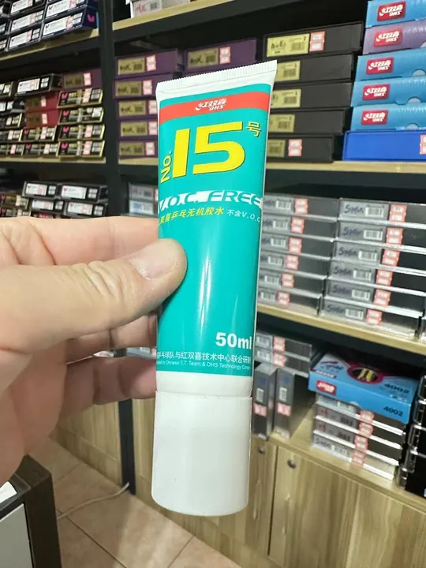
      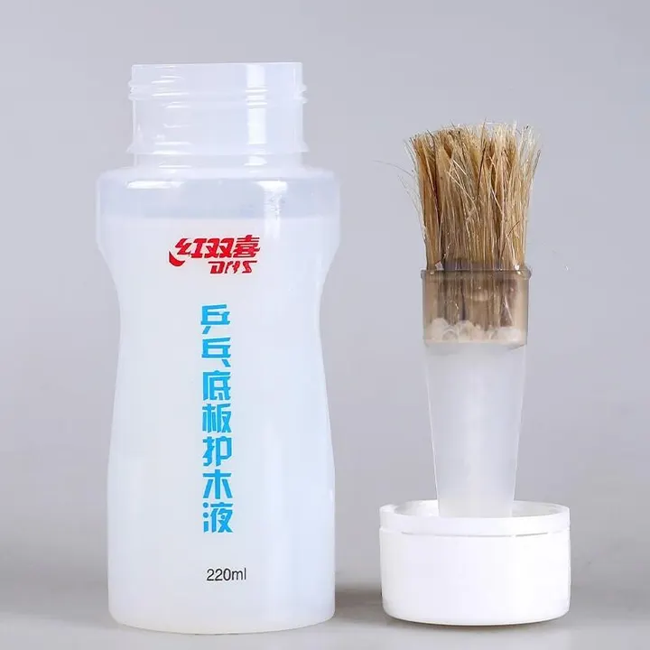
      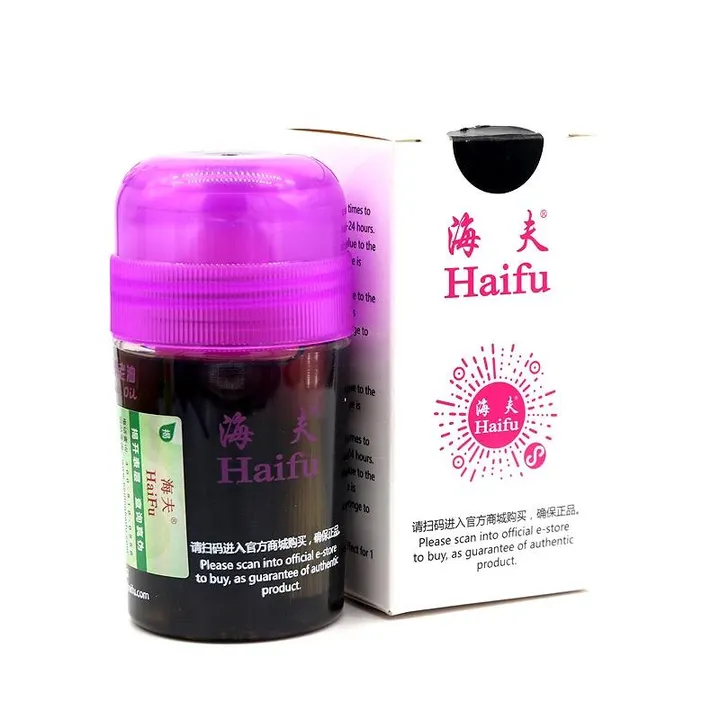
      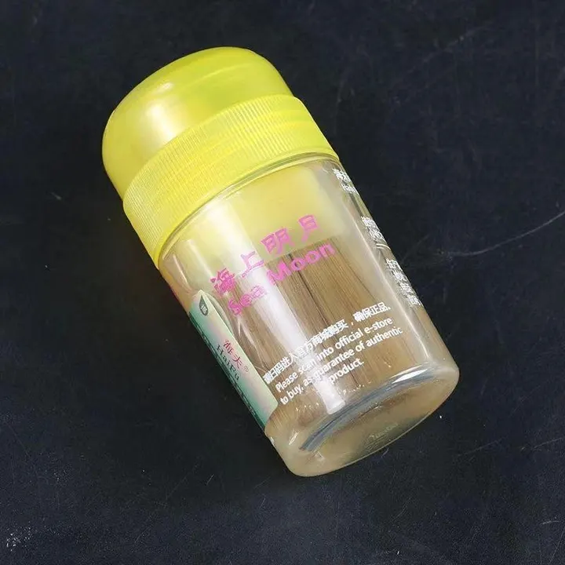
      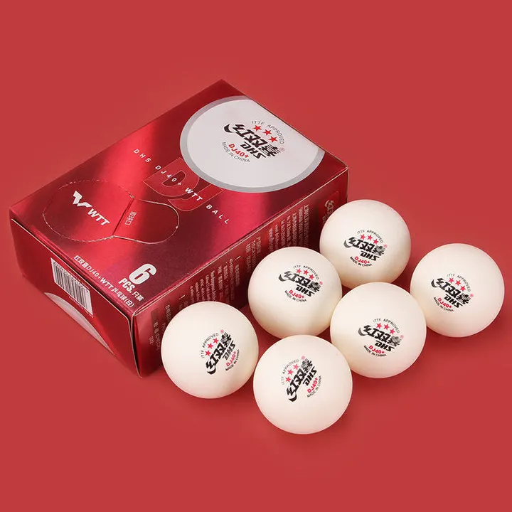
      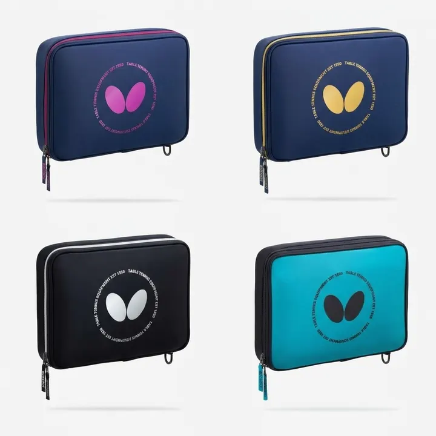
    

    

      
MyGear.Top

      <h1 class="mg-home-hero__title">Table Tennis Accessories</h1>
      
Glue, boosters, balls, cases and care kits — prices are in <strong>USD</strong>. Tap <strong>+</strong> to build a cart, then WhatsApp checkout for your final total (items + shipping).

      

        <a class="mg-home-hero__btn mg-home-hero__btn--primary" href="https://wa.me/8618627156285?text=Hello%2C%20I%27d%20like%20a%20quote%20for%20table%20tennis%20accessories.%0D%0A%0D%0AShip%20to%20(city%20%2F%20postal%20code)%3A%0D%0A%0D%0A">Get a quote</a>
        <a class="mg-home-hero__btn mg-home-hero__btn--ghost" href="/order/">How to Order</a>
      

    

  </section>

  <!-- 2026-11-07 (user: 「将首页中的 Fan Zhendong's match shoe $125 / Li-Ning
       Qilin 2.0 PE 移到 http://127.0.0.1:8001/etc/ 页中」): the Qilin card
       left the homepage and opens this grid now. Markup, price, photos and
       behaviour are unchanged — only where it sits. Its own history, from the
       day it joined the homepage on 2026-11-04, still explains its shape:

       First (user: 「将 https://mygear.top/add-ons/ 页中的 Li-Ning Qilin 2.0 PE
       $125 移到 https://mygear.top/gear/ 中我想看看效果」) it left /add-ons/ and
       was rewritten in the homepage grid's recipe — 3:2 band, title with the
       price at its end, one action line. Second pass, same day (user: 「将 主标题
       和副标题合并成主标题，然后将 The Li-Ning Qilin 2.0 PE is the table tennis
       shoe… 去掉… 参考 acebase.cc/gear/ 的卡片样式」): the subtitle joined the
       title after an em dash and the paragraph came off, the shape the add-ons
       cards below have. Third pass, same day (user: 「将 Li-Ning Qilin 2.0 PE —
       Fan Zhendong's match shoe $125 … 的标题改为 Fan Zhendong's match shoe，
       描述改为 Li-Ning Qilin 2.0 PE」): the two halves swapped — the title is
       the line that says what the shoe is, the price still at its end, and the
       product's own name sits under it as the card's one-line .mg-card__desc.

       What it brought over from /add-ons/ is its substance: the photo set in
       data-gallery, the $125 price, and the .mg-cart-add button price-cart.js
       binds on any .mg-card. No data-lightbox-spec, so the lightbox opens
       bare like the player cards'. The photos are the shop's own; nothing was
       reshot.

       2026-11-07, later (user: 「将 … 的第1和第3张图删除」): 01 (the pair on
       the balcony) and 03 (one shoe on a leg, in a shop) came out of the set,
       leaving five — 02 the boxed pair in tissue paper, then the four match
       shots 04–07. 02 is the cover now, so the card's src, data-full-src and
       srcset were repointed at it; 02 has a .thumb.webp and its original,
       nothing between, so the srcset is those two widths (540w / 960w) and
       not the four-step ladder 01 had. 01 and 03 keep their files under
       /images/lining-qilin-2-pe/ — nothing on the site points at them now. -->
  <article class="mg-card">
    

      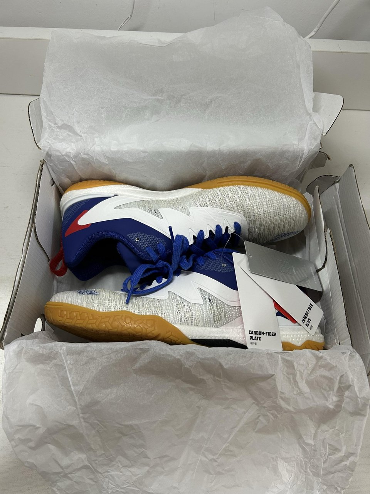
    

    
      <h2 class="mg-card__title">Fan Zhendong's match shoe $125</h2>
      
Li-Ning Qilin 2.0 PE

      

        <button type="button" class="mg-cart-add" aria-label="Add Li-Ning Qilin 2.0 PE to cart" data-name="Li-Ning Qilin 2.0 PE" data-price="125">Add to cart</button>
      

    

  </article>

  <!-- 2026-11-04 (user: 「将 http://127.0.0.1:8001/add-ons/ 页的商品全都移至
       http://127.0.0.1:8001/gear/」): the fifteen add-ons products left their
       own page and close this grid, written in this page's card recipe like
       the Qilin shoe above — 3:2 band, title with the price at its end, one
       action line. No paragraph: /add-ons/ carried none, and nothing is
       written here to fill the slot. Photo, alt, srcset and data-gallery are
       /add-ons/' originals; only `sizes` follows this grid's wider column.
       data-name / data-price are the same strings, so a cart saved before the
       move still matches its line. The order is /add-ons/' own.

       Two of the fifteen left on 2026-11-04's sixth pass — LIU LAN Rubber
       Nutrition Liquid (100ml) and LOKI Table Tennis Rubber Cleaner Foam
       (200ml), see the note at the top of the grid — so thirteen stand here
       now.

       Seventh pass, the same day (user: 「新增ETC类目，将 DHS No.15
       VOC-Free Glue $8 及后面的卡片都移至ETC」): these thirteen left /gear/
       for a page of their own — cards and note together, unchanged apart
       from where they sit. /gear/ itself merged into the homepage.
       -->

  <article class="mg-card">
    

      
    

    
      <h2 class="mg-card__title">DHS No.15 VOC-Free Glue $8</h2>
      

        <button type="button" class="mg-cart-add" aria-label="Add DHS No.15 VOC-Free Glue to cart" data-name="DHS No.15 VOC-Free Glue" data-price="8">Add to cart</button>
      

    

  </article>

  <article class="mg-card">
    

      
    

    
      <h2 class="mg-card__title">DHS Blade Professional Lacquer $10</h2>
      

        <button type="button" class="mg-cart-add" aria-label="Add DHS Blade Professional Lacquer to cart" data-name="DHS Blade Professional Lacquer" data-price="10">Add to cart</button>
      

    

  </article>

  <article class="mg-card">
    

      
    

    
      <h2 class="mg-card__title">Haifu National Black Oil $18</h2>
      

        <button type="button" class="mg-cart-add" aria-label="Add Haifu National Black Oil to cart" data-name="Haifu National Black Oil" data-price="18">Add to cart</button>
      

    

  </article>

  <article class="mg-card">
    

      
    

    
      <h2 class="mg-card__title">Haifu Sea Moon Booster $8</h2>
      

        <button type="button" class="mg-cart-add" aria-label="Add Haifu Sea Moon Booster to cart" data-name="Haifu Sea Moon Booster" data-price="8">Add to cart</button>
      

    

  </article>

  <article class="mg-card">
    

      
    

    
      <h2 class="mg-card__title">DHS 3-Star Balls $5</h2>
      

        <button type="button" class="mg-cart-add" aria-label="Add DHS 3-Star Balls to cart" data-name="DHS 3-Star Balls" data-price="5">Add to cart</button>
      

    

  </article>

  <article class="mg-card">
    

      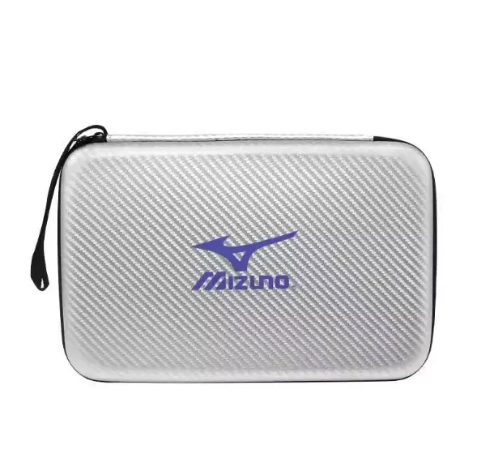
    

    
      <h2 class="mg-card__title">Hard Case for Racket $5</h2>
      

        <button type="button" class="mg-cart-add" aria-label="Add Hard Case for Racket to cart" data-name="Hard Case for Racket" data-price="5">Add to cart</button>
      

    

  </article>

  <article class="mg-card">
    

      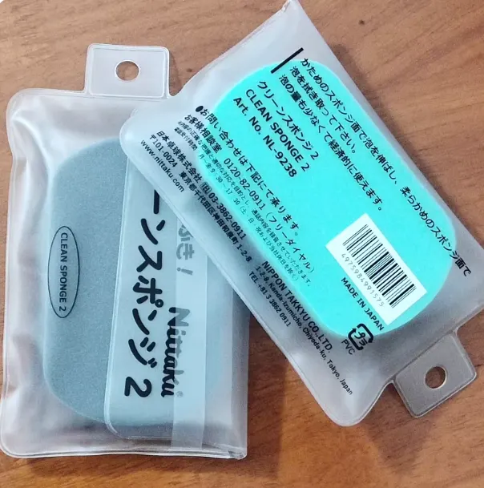
    

    
      <h2 class="mg-card__title">Nittaku Cleaning Sponge $1</h2>
      

        <button type="button" class="mg-cart-add" aria-label="Add Nittaku Cleaning Sponge to cart" data-name="Nittaku Cleaning Sponge" data-price="1">Add to cart</button>
      

    

  </article>

  <article class="mg-card">
    

      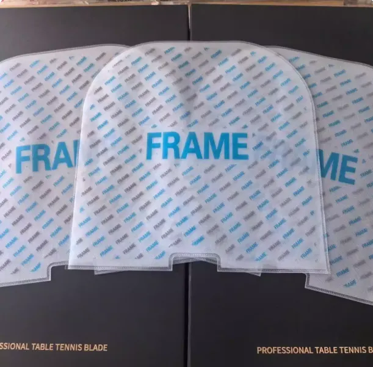
    

    
      <h2 class="mg-card__title">Rubber Protective Sleeve $1</h2>
      

        <button type="button" class="mg-cart-add" aria-label="Add Rubber Protective Sleeve to cart" data-name="Rubber Protective Sleeve" data-price="1">Add to cart</button>
      

    

  </article>

  <article class="mg-card">
    

      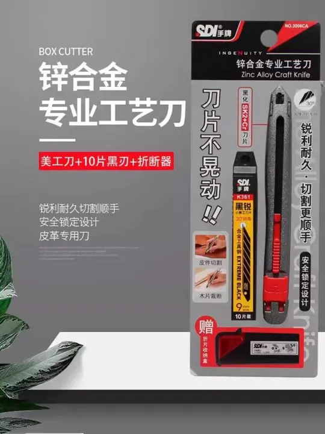
    

    
      <h2 class="mg-card__title">SDI 3006C Rubber Cutter $5</h2>
      

        <button type="button" class="mg-cart-add" aria-label="Add SDI 3006C Rubber Cutter to cart" data-name="SDI 3006C Rubber Cutter" data-price="5">Add to cart</button>
      

    

  </article>

  <article class="mg-card">
    

      
    

    
      <h2 class="mg-card__title">Butterfly 2025 Racket Case $30</h2>
      

        <button type="button" class="mg-cart-add" aria-label="Add Butterfly 2025 Racket Case to cart" data-name="Butterfly 2025 Racket Case" data-price="30">Add to cart</button>
      

    

  </article>

  <article class="mg-card">
    

      
    

    
      <h2 class="mg-card__title">Butterfly Wristband $10</h2>
      

        <button type="button" class="mg-cart-add" aria-label="Add Butterfly Wristband to cart" data-name="Butterfly Wristband" data-price="10">Add to cart</button>
      

    

  </article>

  <article class="mg-card">
    

      
    

    
      <h2 class="mg-card__title">Butterfly 2026 Racket Bag $31</h2>
      

        <button type="button" class="mg-cart-add" aria-label="Add Butterfly 2026 Racket Bag to cart" data-name="Butterfly 2026 Racket Bag" data-price="31">Add to cart</button>
      

    

  </article>

  <article class="mg-card">
    

      
    

    
      <h2 class="mg-card__title">Butterfly 2026 Sports Towel $6</h2>
      

        <button type="button" class="mg-cart-add" aria-label="Add Butterfly 2026 Sports Towel to cart" data-name="Butterfly 2026 Sports Towel" data-price="6">Add to cart</button>
      

    

  </article>

  
Related

  
<a href="/blades/">Blades</a> · <a href="/rubbers/">Rubbers</a> · <a href="/pre-owned/">Pre-owned</a> · <a href="/order/">How to Order</a> · <a href="/FAQ/">FAQ &amp; Shipping</a>

