

  <section class="mg-home-hero mg-home-hero--shop mg-hero-slides" aria-label="Table tennis gear">
    

      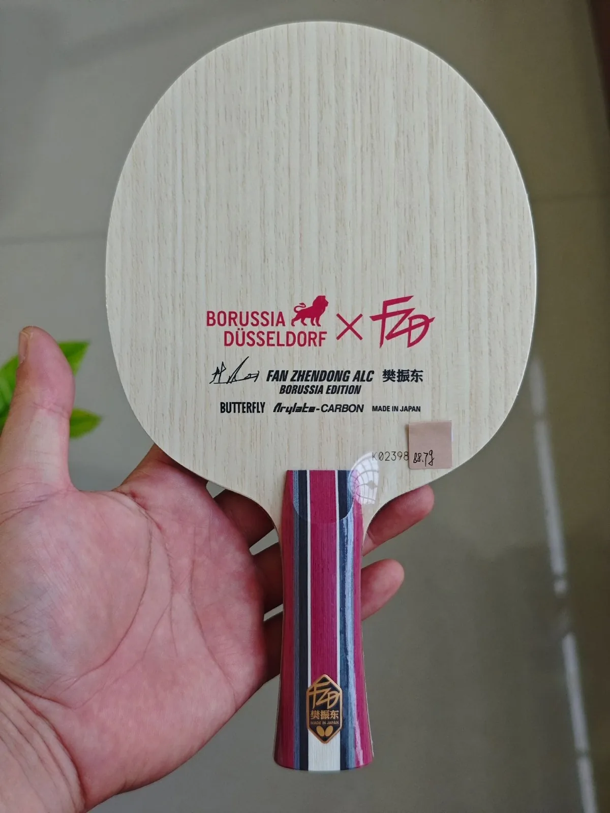
      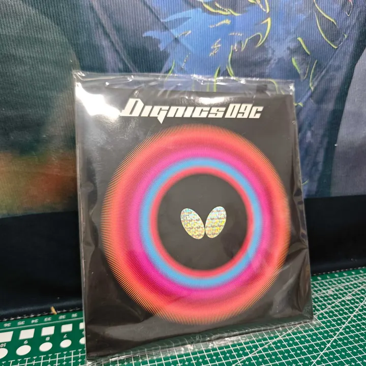
      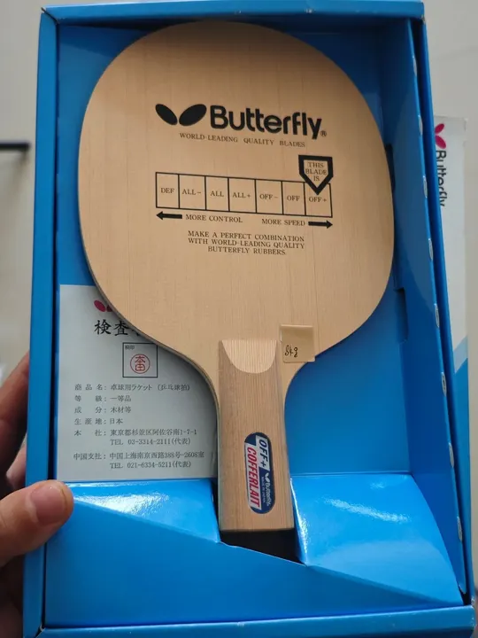
      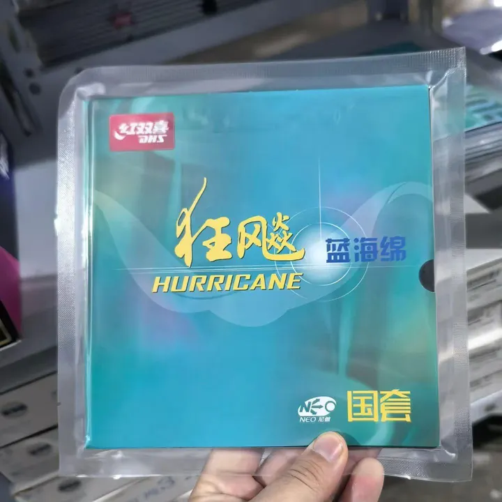
      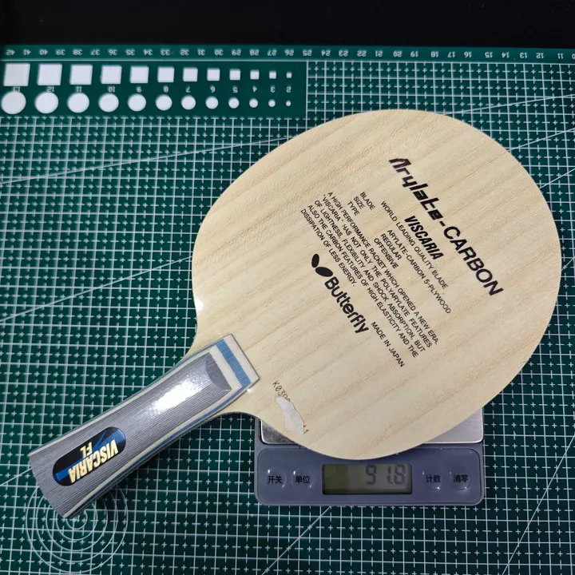
      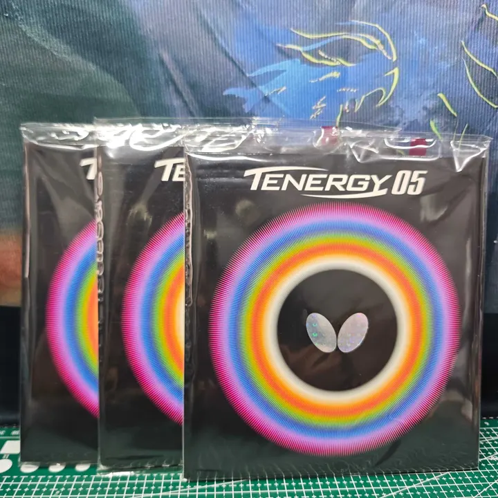
    

    

      
MyGear.Top

      <h1 class="mg-home-hero__title">Custom Table Tennis Racket Setups &amp; Pro Combos</h1>
      
Pro player rackets, iconic combos, and community custom builds. Want to showcase your setup? Send us your racket specs and tell us how it plays on WhatsApp!

      

        <a class="mg-home-hero__btn mg-home-hero__btn--primary" href="https://wa.me/8618627156285?text=Hi%2C%20I%27d%20like%20to%20showcase%20my%20setup.%0D%0A%0D%0ARacket%20specs%3A%0D%0AHow%20it%20plays%3A%0D%0A%0D%0A">Send us your setup</a>
        <a class="mg-home-hero__btn mg-home-hero__btn--ghost" href="/order/">How to Order</a>
      

    

  </section>

<!-- Twenty-five cards, in two parts. The first twelve open the page: eleven
     players' own setups, and — first in the grid since 2026-11-04 — the
     Li-Ning Qilin 2.0 PE moved over from /add-ons/ (see the note over its
     card), a product in this grid's shape: picture, one title with the price
     at its end, one action — and, since its third pass that day, the product's
     name on a line under the title. The
     other thirteen, closing the grid, are the rest of /add-ons/, moved here
     the same day (their own note is at the end of the grid).

     2026-11-04, later in the day (user: 「将页面中的其它卡片，比如 Butterfly
     Fan Zhendong ALC / Butterfly Dignics 09C · Butterfly ZYRE-03 的标题就应该
     是 Sora Matsushima · Okayama 的装备 Butterfly Fan Zhendong ALC」): the
     player cards took that same shape. The paragraph that used to open "Sora
     Matsushima · Okayama Rivets plays the Butterfly Fan Zhendong ALC with …"
     came off, its identity moved up into the title and the rest left to the
     player's page.

     Then, the same day (user: 「不需要队员的国家以及俱乐部名称，然后将副标题
     合并到主标题」): the country or club after the player's name went, and the
     rubber line was folded into the title with it — "Sora Matsushima —
     Butterfly Fan Zhendong ALC — Butterfly Dignics 09C · Butterfly ZYRE-03".
     The rubbers' non-breaking spaces are ordinary spaces up here (see the note
     where .mg-card__sub used to be in uncrate.css): held together the longest
     of those lines is wider than a phone column.

     And again, the same day (user: 「将其它卡片也同样进行处理」, after the
     Qilin card split into a phrase as its title and the product name as its
     description): the player cards took that split. The title is the person —
     "Sora Matsushima's setup", the page's own way of naming a card about a
     player, beside "Fan Zhendong's match shoe" on the card above — and the
     gear drops to the description line: "Butterfly Fan Zhendong ALC —
     Butterfly Dignics 09C · Butterfly ZYRE-03", the blade, an em dash, the
     rubber pair, in the order it stood in the title. The fifteen product
     cards keep "name + price" as their titles: they have no phrase of the
     page's own to lead with, and none was invented for them.

     Fifth pass, the same day (user: 「将页面中有价格的都只保留 add to cart，将
     没有价格的都只保留 Ask about this setup」): every action line now holds one
     control. The sixteen cards with a price keep the Add to cart button and
     lose the "or Ask about this item" link beside it; the eleven player cards
     keep "Ask about this setup" — the WhatsApp quote link that carries the
     blade and rubbers into the message — and lose "View his gear". The
     .mg-card__more--split block stays around the one control, because that is
     the class that styles it as the underlined, centred link line.

     Sixth pass, the same day (user pasted the LIU LAN Rubber Nutrition Liquid
     (100ml) $6 and LOKI Table Tennis Rubber Cleaner Foam (200ml) $3 cards and
     said 「删除」): those two came off the grid with their photos, leaving
     fourteen priced cards. Their images are still under /images/add-ons/
     (liu-lan-rubber-nutrition-liquid-100ml and
     loki-table-tennis-rubber-cleaner-foam200ml); nothing on the site points
     at them now. A cart saved before this still carries their lines until it
     is cleared — the page no longer prices them.

     The eleven player pages are not orphaned by that: /gear/sora-matsushima/,
     /gear/wang-chuqin/, /gear/tomokazu-harimoto/, /gear/dang-qiu/,
     /gear/patrick-franziska/, /gear/felix-lebrun/, /gear/lin-yun-ju/,
     /gear/truls-moregardh/, /gear/hugo-calderano/, /gear/lin-shidong/ and
     /gear/fan-zhendong/ — the pages with the lists in full — are each linked
     from the homepage (docs/index.md).

     2026-10-28: the eleven builds for sale that used to share this page — four
     ahead of the players, seven behind them — were taken down at the shop's
     asking, so the page is players only now. Their photos are still under
     /images/ (viscaria-d09c-d05 and the ten others); nothing on the site
     points at them any more.

     The link is a plain anchor, not .mg-card__zoom, and that is deliberate:
     the zoom class hands a click to gallery-lightbox.js (the lightbox) and
     puts the card in front of card-read-more.js. Without it the photo still
     opens the lightbox and its sheet, and the link navigates. No card in this
     grid carries a description for that script to measure any more (the player
     cards lost theirs on 2026-11-04, above): the only descriptions left on the
     site are the homepage feed's. The eleven blades that used to carry
     write-ups are on /blades/ now and lost them there too: they are written in
     the priced-card recipe, which has no paragraph slot.

     The pairing is written forehand first — the order the Forehand / Backhand
     table it replaced carried — because rubber names on their own do not say
     which side each is on, and that order is now the only thing that does. The
     .mg-card--player class still carries its weight: it is what
     .mg-price-thumb-count in extra.css is hidden under, so the lightbox's count
     pill is never drawn over the band. -->

  <!-- 2026-11-04 (user: 「将 https://mygear.top/add-ons/ 页中的 Li-Ning Qilin
       2.0 PE $125 移到 https://mygear.top/gear/ 中我想看看效果」): the Qilin
       card left /add-ons/ and came here, rewritten in this page's own recipe —
       3:2 band, title with the price at its end, and an action line — so it
       reads as a card of this grid and not a shop card dropped into it.

       Same day, second pass (user: 「将 主标题和副标题合并成主标题，然后将 The
       Li-Ning Qilin 2.0 PE is the table tennis shoe… 去掉… 参考
       acebase.cc/gear/ 的卡片样式」): the subtitle "Fan Zhendong's match shoe"
       is now the tail of the title, after an em dash, and the paragraph is
       gone. The card is picture, one title, one action — the shape an
       acebase.cc /gear/ card has. That is also the shape of the add-ons
       cards below, so the whole grid now closes the same way.

       Third pass, same day (user: 「将 Li-Ning Qilin 2.0 PE — Fan Zhendong's
       match shoe $125 … 的标题改为 Fan Zhendong's match shoe，描述改为
       Li-Ning Qilin 2.0 PE」): the two halves swap places. The title is now the
       line that says what the shoe is — "Fan Zhendong's match shoe" — with the
       price still at its end, and the product's own name sits under it as the
       card's one-line .mg-card__desc. The words are the same two the card has
       carried since it came over; only which one leads changed.
       What it keeps from /add-ons/ is its substance: the
       seven-photo set in data-gallery (01 is the boxed pair, the cover, and
       the same file the add-ons card used), the $125 price, and the
       .mg-cart-add button price-cart.js binds on any .mg-card. No
       data-lightbox-spec, so the lightbox opens bare like the player cards'.
       The photos are the shop's own; nothing here was reshot. -->
  <article class="mg-card">
    

      
    

    
      <h2 class="mg-card__title">Fan Zhendong's match shoe $125</h2>
      
Li-Ning Qilin 2.0 PE

      

        <button type="button" class="mg-cart-add" aria-label="Add Li-Ning Qilin 2.0 PE to cart" data-name="Li-Ning Qilin 2.0 PE" data-price="125">Add to cart</button>
      

    

  </article>

  <!-- The second card. Sora Matsushima's own setup, taken from his Takkyu-Navi
       profile: the blade, both rubbers and what they replaced, the shoes and
       the shirt. The title names him — "Sora Matsushima's setup" — and the
       description under it carries the blade and the rubber pair; the
       paragraph that used to spell the gear list out here — and what each
       piece replaced — was folded away on 2026-11-04 (see the note at the top
       of the grid). The card's one action is "Ask about this setup", a quote
       link into WhatsApp; the full list still runs whole on
       /gear/sora-matsushima/, which the homepage links to. The rubbers keep
       the page's order: forehand first.

       The band above the copy is an action shot, and its source is a tall
       poster graphic — the stroke on top, then a caption that names the same
       gear the subtitle does, then the credits. The band is cut from the top
       of that graphic at exactly 3:2 and stops above the caption, so the card
       shows the stroke and nothing the card or the lightbox already says.

       The lightbox is photos only: the card carries no data-lightbox-spec and
       no <template>, so gallery-lightbox.js finds nothing to put under the
       picture and leaves .mg-lightbox__caption hidden — the image opens bare,
       with just the counter and the arrows, and walks the rest of the gear:
       each rubber, the shoes, the shirt. Each data-gallery entry is
       "href|alt" and galleryEntry() reads it as such; the alts are written
       without commas because the list is split on them. The count pill the
       galleries normally draw over the band is hidden here
       (.mg-card--player .mg-price-thumb-count in extra.css), so nothing sits
       on the picture on the card either. The player's own portrait is not in
       the set: the card is about the gear. The blade and both rubbers are the
       shop's own product photos, the same files /blades/ and the rubber cards
       show; only the shoes and the shirt had to be brought over from the
       profile, which has no larger file than 450px for either. -->

  <article class="mg-card mg-card--player">
    

      
    

    
      <h2 class="mg-card__title">Sora Matsushima's setup</h2>
      
Butterfly Fan Zhendong ALC — Butterfly Dignics 09C · Butterfly ZYRE-03

      

        <a class="mg-card__ask" href="https://wa.me/8618627156285?text=Hi%2C%20I%27d%20like%20a%20quote%20for%20a%20Fan%20Zhendong%20ALC%20with%20Dignics%2009C%20and%20ZYRE-03.%0D%0A%0D%0AShip%20to%20(city%20%2F%20postal%20code)%3A%0D%0A%0D%0A" target="_blank" rel="noopener noreferrer">Ask about this setup</a>
      

    

  </article>

  <!-- The second card, the second of the player cards, reads exactly as the
       first does. Wang Chuqin's list is shorter than Sora Matsushima's — the
       blade and two rubbers, no shoes or shirt on his Takkyu-Navi profile — so
       there was the less to say in the paragraph both cards had until
       2026-11-04; the list is on /gear/wang-chuqin/ in full.

       The band was the profile's celebration frame, cut to 3:2 above the chest
       and scaled to 1200 — the one soft file on the card, because the profile
       carries that frame at 360px and nothing larger. It is still the right
       kind of band: the same card built from the cut-out on white left a
       half-torso floating in a white strip that read as a missing photo.
       2026-10-26: the band is now a sharp 3226x2160 celebration shot from
       behind (CHINA / Wang C.Q. across the back, both arms up to the crowd).
       Same argument as before — a person, not a cut-out — and at the source's
       own 1.49:1 the card's 3:2 frame crops almost nothing off it. The lightbox is
       photos only, like the fifth card — no sheet, no note under the picture;
       the portrait cut-out is not in the set. The two rubber shots are the
       profile's own catalogue photos of the boxes it lists, doubled on the way
       in, since 450px is the largest rung the profile has. The blade shot is
       the shop's, not the profile's: the profile files his "Hurricane King"
       under the all-wood retail blade's name, but the National Q968 he plays
       is the composite one, and that is the photo /blades/ carries. -->

  <article class="mg-card mg-card--player">
    

      
    

    
      <h2 class="mg-card__title">Wang Chuqin's setup</h2>
      
DHS Q968 — DHS Hurricane 3 National · DHS Hurricane 8

      

        <a class="mg-card__ask" href="https://wa.me/8618627156285?text=Hi%2C%20I%27d%20like%20a%20quote%20for%20a%20DHS%20Q968%20with%20Hurricane%203%20National%20blue%20sponge%20and%20Hurricane%208.%0D%0A%0D%0AShip%20to%20(city%20%2F%20postal%20code)%3A%0D%0A%0D%0A" target="_blank" rel="noopener noreferrer">Ask about this setup</a>
      

    

  </article>

  <!-- The third card, the third of the player cards, reads exactly as the
       two above it do. Harimoto's list is the full one — blade, both
       rubbers, shoes and shirt, all from his Takkyu-Navi profile — so the
       paragraph carries the gear and the two wings' histories: Tenergy 80 then
       05 on the forehand, 05FX then 05 on the backhand, and the Harimoto
       Innerforce ALC on the blade before this one.

       The band was the profile's 450x435 action frame until 2026-10-26, when
       the shop supplied a 762x762 still of him shouting; the 3:2 window is cut
       from that and left at 762 rather than upscaled to 1200, so it is the one
       band on the page that ends below a 1000 rung.

       The lightbox is photos only, like the two player cards above: no sheet,
       no note under the picture, and the portrait is not in the set. The
       blade, shoes and shirt are the profile's catalogue photos at their 450px
       ceiling; the rubber shot is the shop's own ZYRE-03 photo, the same file
       /gear/zyre-03/ and the rubber cards show. -->

  <article class="mg-card mg-card--player">
    

      
    

    
      <h2 class="mg-card__title">Tomokazu Harimoto's setup</h2>
      
Butterfly Harimoto Innerforce Super ALC — Butterfly ZYRE-03 · Both Sides

      

        <a class="mg-card__ask" href="https://wa.me/8618627156285?text=Hi%2C%20I%27d%20like%20a%20quote%20for%20a%20Harimoto%20Innerforce%20Super%20ALC%20with%20ZYRE-03%20on%20both%20sides.%0D%0A%0D%0AShip%20to%20(city%20%2F%20postal%20code)%3A%0D%0A%0D%0A" target="_blank" rel="noopener noreferrer">Ask about this setup</a>
      

    

  </article>

  <!-- The fourth to the tenth card: built against the seven Takkyu-Navi
       profiles added on 2026-10-26 (283, 121, 6992, 1898, 416, 134, 8663).
       Same recipe as the Harimoto card above — no
       data-lightbox-spec, no <template>, the portrait left out of the gallery,
       the paragraph clamped, and (until 2026-11-04) "View his gear" a plain
       anchor into the album; the action is now the WhatsApp quote link alone.

       The bands were the profiles' own photographs until 2026-10-26; they are
       now stills the shop supplied for these seven and Harimoto (the same
       evening), and the seven of these are all 3:2 windows cut out of larger
       frames — 3240x2160 for Lebrun and 2940x2160 for Lin Shidong down to
       1080x1453 for Lin Yun-Ju, whose poster puts a "WTT INCHEON" badge where
       the window would start, so his band begins below it and takes the top of
       his hair with it. Bands are written at 1200 where the source has it
       (Lebrun, Moregardh, Calderano, Lin Shidong) and at 1080 from the three
       1080-wide frames (Dang Qiu, Franziska, Lin Yun-Ju). The gear photographs
       are unchanged.

       Two of these seven cards titled a rubber rather than a blade until
       2026-10-26, when the blades were named and the titles rewritten. Dang Qiu
       plays a Timo Boll ALC in a special order, a penhold: Butterfly's own
       write-up (Takurepo, equipment as of February 2025) gives the material only,
       so the model came from the shop. Lin Shidong plays the gold-label
       Viscaria, a player special order rather than the market blade by the
       Chinese equipment write-ups. Both titles name the model and leave the
       special order to the paragraph and the album.

       Lin Yun-Ju's title carried his name in brackets until 2026-10-26, to keep
       it apart from the build card below it that had the same blade on it
       ("Butterfly Viscaria Super ALC", with 729 Battle II and Hurricane III).
       The brackets were asked for gone that day, which left the page carrying
       that h2 twice and the search index giving the second its own "-2" anchor;
       the build cards came out on 2026-10-28, so it is once now.

       The gear photos are the profile's own catalogue shots at that same 450px
       ceiling, except where the shop already has a better file: the ZYRE-03 and
       Dignics shots are the product photos /gear/zyre-03/ and the Dignics pages
       show, and Moregardh's blade is the shop's own Cybershape Truls Edition
       photo from /blades/ — his profile racket image is a Japanese sales poster,
       not the blade. The alts are written without commas because
       galleryEntry() splits data-gallery on them. -->

  <article class="mg-card mg-card--player">
    

      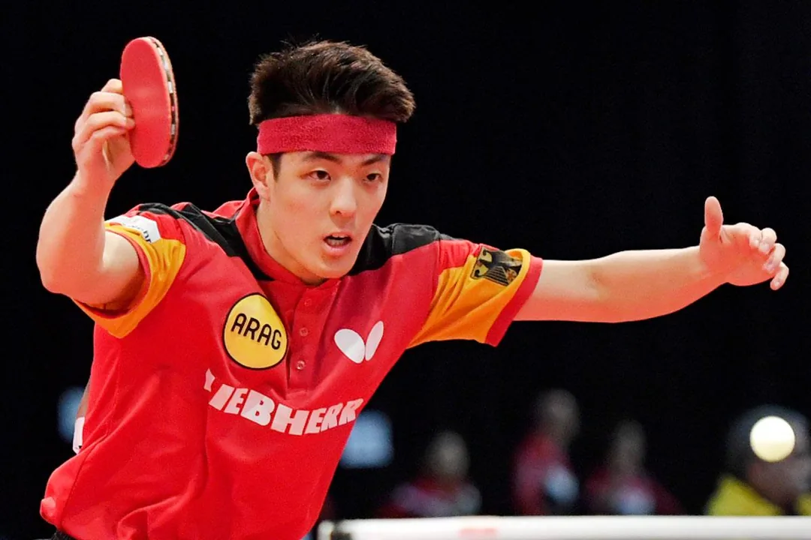
    

    
      <h2 class="mg-card__title">Dang Qiu's setup</h2>
      
Butterfly Timo Boll ALC — Butterfly Dignics 09C · Both Sides

      

        <a class="mg-card__ask" href="https://wa.me/8618627156285?text=Hi%2C%20I%27d%20like%20a%20quote%20for%20a%20Dignics%2009C%20on%20both%20sides%20of%20a%20penhold%20blade.%0D%0A%0D%0AShip%20to%20(city%20%2F%20postal%20code)%3A%0D%0A%0D%0A" target="_blank" rel="noopener noreferrer">Ask about this setup</a>
      

    

  </article>

  <article class="mg-card mg-card--player">
    

      
    

    
      <h2 class="mg-card__title">Patrick Franziska's setup</h2>
      
Butterfly Franziska Innerforce ZLC — Butterfly ZYRE-03 · Both Sides

      

        <a class="mg-card__ask" href="https://wa.me/8618627156285?text=Hi%2C%20I%27d%20like%20a%20quote%20for%20a%20Franziska%20Innerforce%20ZLC%20with%20ZYRE-03%20on%20both%20sides.%0D%0A%0D%0AShip%20to%20(city%20%2F%20postal%20code)%3A%0D%0A%0D%0A" target="_blank" rel="noopener noreferrer">Ask about this setup</a>
      

    

  </article>

  <article class="mg-card mg-card--player">
    

      
    

    
      <h2 class="mg-card__title">Félix Lebrun's setup</h2>
      
Tibhar Félix Lebrun Hyper Carbon — Tibhar Hybrid K3 Pro · Both Sides

      

        <a class="mg-card__ask" href="https://wa.me/8618627156285?text=Hi%2C%20I%27d%20like%20a%20quote%20for%20a%20Felix%20Lebrun%20Hyper%20Carbon%20with%20Hybrid%20K3%20Pro%20on%20both%20sides.%0D%0A%0D%0AShip%20to%20(city%20%2F%20postal%20code)%3A%0D%0A%0D%0A" target="_blank" rel="noopener noreferrer">Ask about this setup</a>
      

    

  </article>

  <article class="mg-card mg-card--player">
    

      
    

    
      <h2 class="mg-card__title">Lin Yun-Ju's setup</h2>
      
Butterfly Viscaria Super ALC — Butterfly ZYRE-03 · Butterfly Dignics 05

      

        <a class="mg-card__ask" href="https://wa.me/8618627156285?text=Hi%2C%20I%27d%20like%20a%20quote%20for%20a%20Viscaria%20Super%20ALC%20with%20ZYRE-03%20on%20the%20forehand%20and%20Dignics%2005%20on%20the%20backhand.%0D%0A%0D%0AShip%20to%20(city%20%2F%20postal%20code)%3A%0D%0A%0D%0A" target="_blank" rel="noopener noreferrer">Ask about this setup</a>
      

    

  </article>

  <article class="mg-card mg-card--player">
    

      
    

    
      <h2 class="mg-card__title">Truls Möregårdh's setup</h2>
      
STIGA Cybershape Carbon — STIGA Helix Platinum XH · Both Sides

      

        <a class="mg-card__ask" href="https://wa.me/8618627156285?text=Hi%2C%20I%27d%20like%20a%20quote%20for%20a%20Cybershape%20Carbon%20with%20Helix%20Platinum%20XH%20on%20both%20sides.%0D%0A%0D%0AShip%20to%20(city%20%2F%20postal%20code)%3A%0D%0A%0D%0A" target="_blank" rel="noopener noreferrer">Ask about this setup</a>
      

    

  </article>

  <article class="mg-card mg-card--player">
    

      
    

    
      <h2 class="mg-card__title">Hugo Calderano's setup</h2>
      
XIOM Hugo Hyper Axylium — Joola Trinity Charged · Joola Trinity Dynamic

      

        <a class="mg-card__ask" href="https://wa.me/8618627156285?text=Hi%2C%20I%27d%20like%20a%20quote%20for%20a%20Hyper%20Axylium%20with%20Trinity%20Charged%20on%20the%20forehand%20and%20Trinity%20Dynamic%20on%20the%20backhand.%0D%0A%0D%0AShip%20to%20(city%20%2F%20postal%20code)%3A%0D%0A%0D%0A" target="_blank" rel="noopener noreferrer">Ask about this setup</a>
      

    

  </article>

  <article class="mg-card mg-card--player">
    

      
    

    
      <h2 class="mg-card__title">Lin Shidong's setup</h2>
      
Butterfly Viscaria Golden — DHS Hurricane 3 Neo · Butterfly Dignics 09C

      

        <a class="mg-card__ask" href="https://wa.me/8618627156285?text=Hi%2C%20I%27d%20like%20a%20quote%20for%20a%20Viscaria%20with%20Hurricane%203%20Neo%20on%20the%20forehand%20and%20Dignics%2009C%20on%20the%20backhand.%0D%0A%0D%0AShip%20to%20(city%20%2F%20postal%20code)%3A%0D%0A%0D%0A" target="_blank" rel="noopener noreferrer">Ask about this setup</a>
      

    

  </article>

  <!-- Fan Zhendong joined 2026-10-28, the eleventh player album. The band is
       him from behind on the Paris table, arms flung out, racket in one hand.
       The lightbox walks the shop's own product photos: the ALC on its box,
       the blue-sponge national sheet in its packet, Dignics 09C. The blade
       history (Viscaria, then Infinity VPS V) and the old backhand rubber
       (Tenergy 05) are the profile's own line, under the gear list. -->

  <article class="mg-card mg-card--player">
    

      
    

    
      <h2 class="mg-card__title">Fan Zhendong's setup</h2>
      
Butterfly Fan Zhendong ALC — DHS Hurricane 3 National · Butterfly Dignics 09C

      

        <a class="mg-card__ask" href="https://wa.me/8618627156285?text=Hi%2C%20I%27d%20like%20a%20quote%20for%20a%20Fan%20Zhendong%20ALC%20with%20Hurricane%203%20National%20on%20the%20forehand%20and%20Dignics%2009C%20on%20the%20backhand.%0D%0A%0D%0AShip%20to%20(city%20%2F%20postal%20code)%3A%0D%0A%0D%0A" target="_blank" rel="noopener noreferrer">Ask about this setup</a>
      

    

  </article>

  <!-- 2026-11-04 (user: 「将 http://127.0.0.1:8001/add-ons/ 页的商品全都移至
       http://127.0.0.1:8001/gear/」): the fifteen add-ons products left their
       own page and close this grid, written in this page's card recipe like
       the Qilin shoe above — 3:2 band, title with the price at its end, one
       action line. No paragraph: /add-ons/ carried none, and nothing is
       written here to fill the slot. Photo, alt, srcset and data-gallery are
       /add-ons/' originals; only `sizes` follows this grid's wider column.
       data-name / data-price are the same strings, so a cart saved before the
       move still matches its line. The order is /add-ons/' own.

       Two of the fifteen left on 2026-11-04's sixth pass — LIU LAN Rubber
       Nutrition Liquid (100ml) and LOKI Table Tennis Rubber Cleaner Foam
       (200ml), see the note at the top of the grid — so thirteen stand here
       now. -->

  <article class="mg-card">
    

      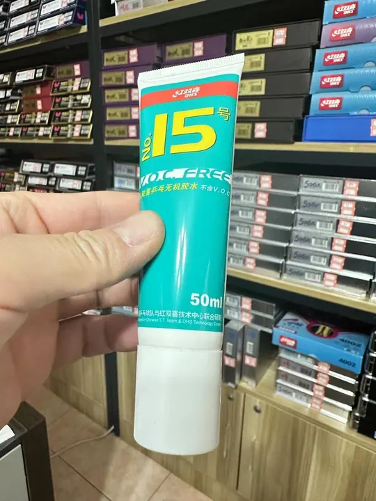
    

    
      <h2 class="mg-card__title">DHS No.15 VOC-Free Glue $8</h2>
      

        <button type="button" class="mg-cart-add" aria-label="Add DHS No.15 VOC-Free Glue to cart" data-name="DHS No.15 VOC-Free Glue" data-price="8">Add to cart</button>
      

    

  </article>

  <article class="mg-card">
    

      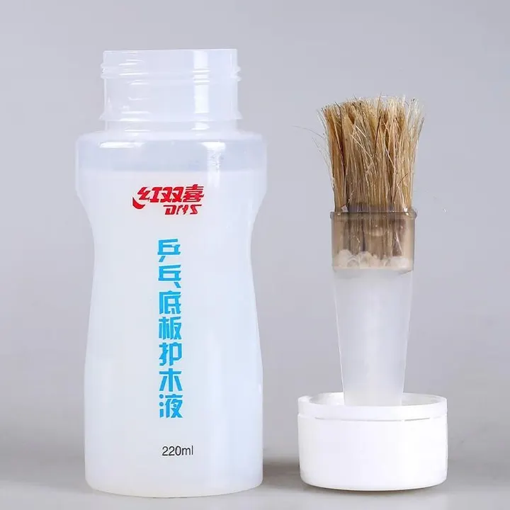
    

    
      <h2 class="mg-card__title">DHS Blade Professional Lacquer $10</h2>
      

        <button type="button" class="mg-cart-add" aria-label="Add DHS Blade Professional Lacquer to cart" data-name="DHS Blade Professional Lacquer" data-price="10">Add to cart</button>
      

    

  </article>

  <article class="mg-card">
    

      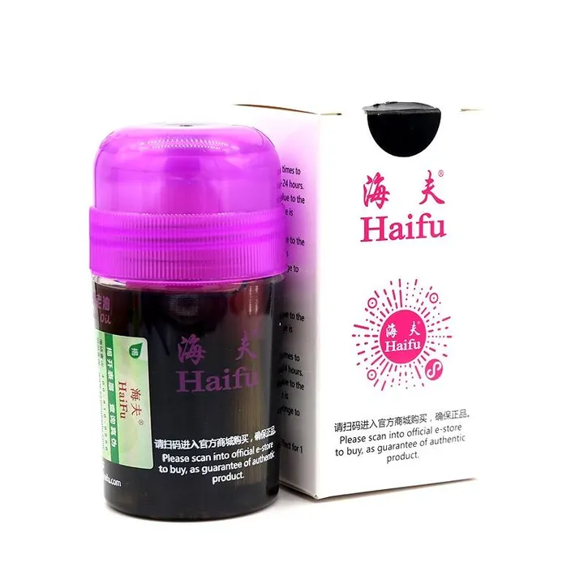
    

    
      <h2 class="mg-card__title">Haifu National Black Oil $18</h2>
      

        <button type="button" class="mg-cart-add" aria-label="Add Haifu National Black Oil to cart" data-name="Haifu National Black Oil" data-price="18">Add to cart</button>
      

    

  </article>

  <article class="mg-card">
    

      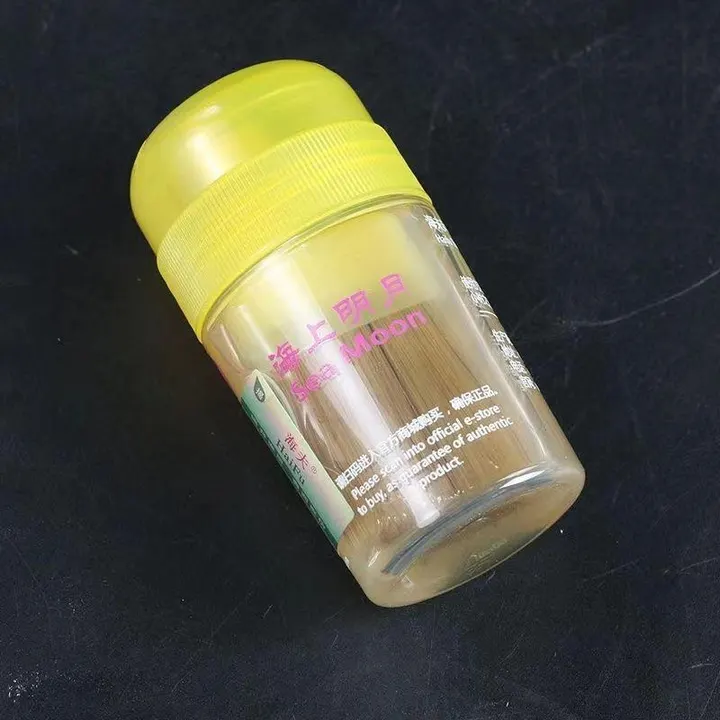
    

    
      <h2 class="mg-card__title">Haifu Sea Moon Booster $8</h2>
      

        <button type="button" class="mg-cart-add" aria-label="Add Haifu Sea Moon Booster to cart" data-name="Haifu Sea Moon Booster" data-price="8">Add to cart</button>
      

    

  </article>

  <article class="mg-card">
    

      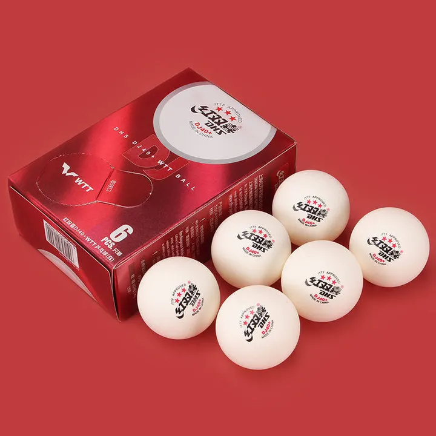
    

    
      <h2 class="mg-card__title">DHS 3-Star Balls $5</h2>
      

        <button type="button" class="mg-cart-add" aria-label="Add DHS 3-Star Balls to cart" data-name="DHS 3-Star Balls" data-price="5">Add to cart</button>
      

    

  </article>

  <article class="mg-card">
    

      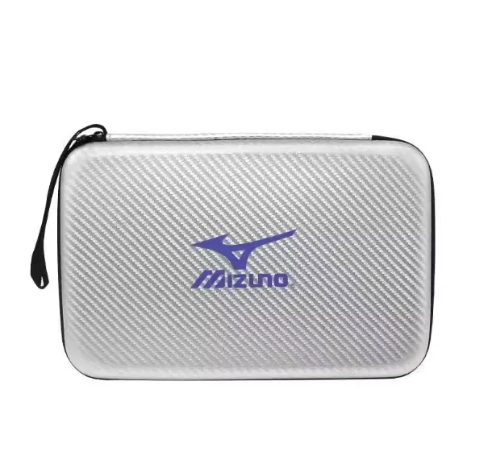
    

    
      <h2 class="mg-card__title">Hard Case for Racket $5</h2>
      

        <button type="button" class="mg-cart-add" aria-label="Add Hard Case for Racket to cart" data-name="Hard Case for Racket" data-price="5">Add to cart</button>
      

    

  </article>

  <article class="mg-card">
    

      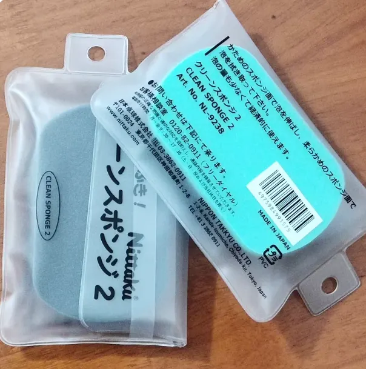
    

    
      <h2 class="mg-card__title">Nittaku Cleaning Sponge $1</h2>
      

        <button type="button" class="mg-cart-add" aria-label="Add Nittaku Cleaning Sponge to cart" data-name="Nittaku Cleaning Sponge" data-price="1">Add to cart</button>
      

    

  </article>

  <article class="mg-card">
    

      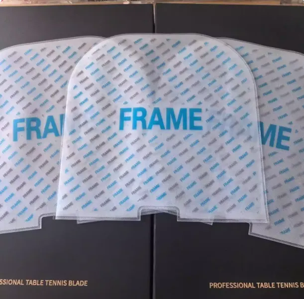
    

    
      <h2 class="mg-card__title">Rubber Protective Sleeve $1</h2>
      

        <button type="button" class="mg-cart-add" aria-label="Add Rubber Protective Sleeve to cart" data-name="Rubber Protective Sleeve" data-price="1">Add to cart</button>
      

    

  </article>

  <article class="mg-card">
    

      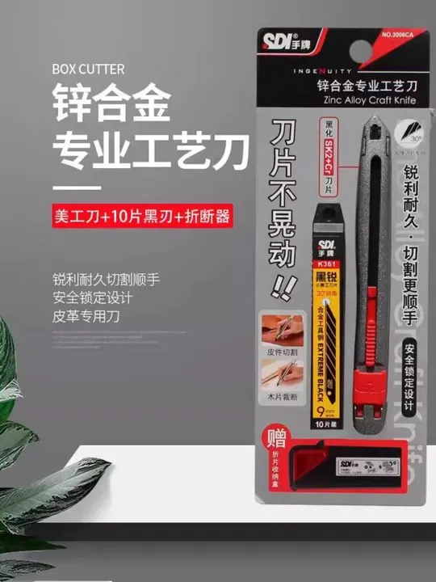
    

    
      <h2 class="mg-card__title">SDI 3006C Rubber Cutter $5</h2>
      

        <button type="button" class="mg-cart-add" aria-label="Add SDI 3006C Rubber Cutter to cart" data-name="SDI 3006C Rubber Cutter" data-price="5">Add to cart</button>
      

    

  </article>

  <article class="mg-card">
    

      
    

    
      <h2 class="mg-card__title">Butterfly 2025 Racket Case $30</h2>
      

        <button type="button" class="mg-cart-add" aria-label="Add Butterfly 2025 Racket Case to cart" data-name="Butterfly 2025 Racket Case" data-price="30">Add to cart</button>
      

    

  </article>

  <article class="mg-card">
    

      
    

    
      <h2 class="mg-card__title">Butterfly Wristband $10</h2>
      

        <button type="button" class="mg-cart-add" aria-label="Add Butterfly Wristband to cart" data-name="Butterfly Wristband" data-price="10">Add to cart</button>
      

    

  </article>

  <article class="mg-card">
    

      
    

    
      <h2 class="mg-card__title">Butterfly 2026 Racket Bag $31</h2>
      

        <button type="button" class="mg-cart-add" aria-label="Add Butterfly 2026 Racket Bag to cart" data-name="Butterfly 2026 Racket Bag" data-price="31">Add to cart</button>
      

    

  </article>

  <article class="mg-card">
    

      
    

    
      <h2 class="mg-card__title">Butterfly 2026 Sports Towel $6</h2>
      

        <button type="button" class="mg-cart-add" aria-label="Add Butterfly 2026 Sports Towel to cart" data-name="Butterfly 2026 Sports Towel" data-price="6">Add to cart</button>
      

    

  </article>

  
Related

  
<a href="/blades/">Blades</a> · <a href="/rubbers/">Rubbers</a> · <a href="/pre-owned/">Pre-owned</a> · <a href="/order/">How to Order</a> · <a href="/FAQ/">FAQ &amp; Shipping</a>

