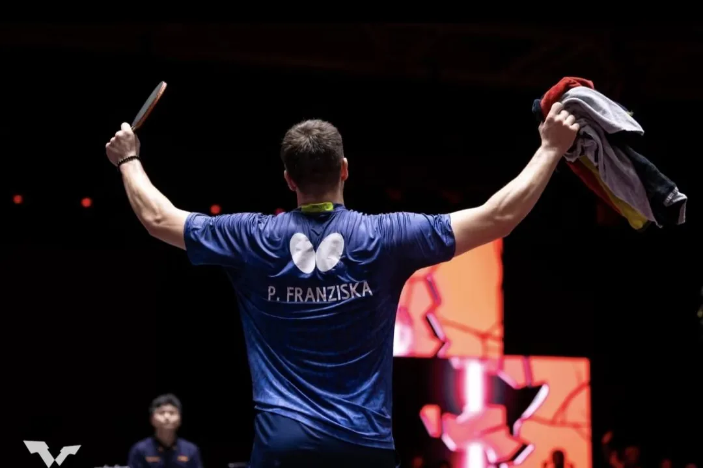
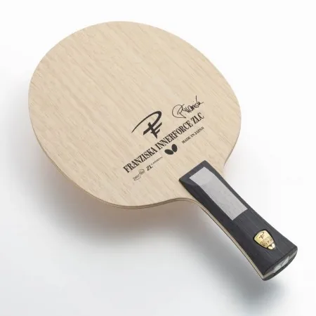
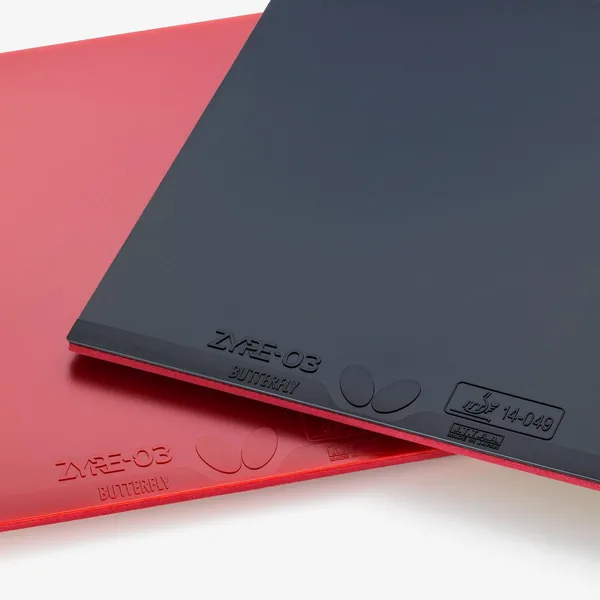
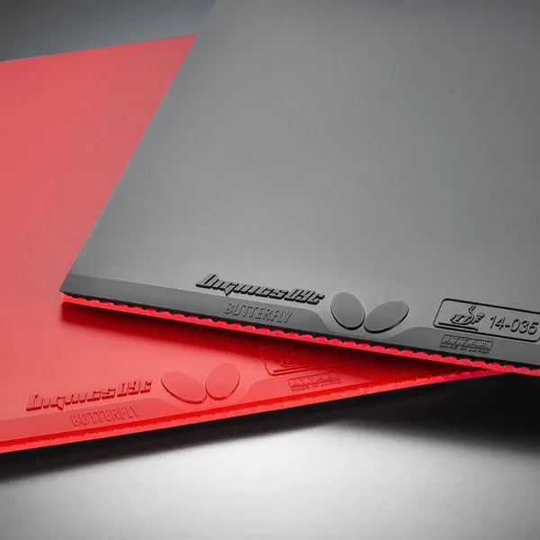

# Patrick Franziska's Gear

The German international Patrick Franziska, world No. 18, plays his signature Butterfly Franziska Innerforce ZLC with ZYRE-03 on the forehand and Dignics 09C on the backhand.

  

    

      
      
      
      
    

  

  

    <ul class="mg-prod-specs">
      <li><strong>Blade</strong> · Butterfly Franziska Innerforce ZLC</li>
      <li><strong>Forehand</strong> · Butterfly ZYRE-03</li>
      <li><strong>Backhand</strong> · Butterfly Dignics 09C</li>
      <li><strong>Country</strong> · Germany</li>
    </ul>
    

      <a class="mg-home-hero__btn mg-home-hero__btn--primary" href="https://wa.me/8618627156285?text=Hi%2C%20I%27d%20like%20a%20quote%20for%20a%20Franziska%20Innerforce%20ZLC%20with%20ZYRE-03%20on%20the%20forehand%20and%20Dignics%2009C%20on%20the%20backhand.%0D%0A%0D%0AShip%20to%20(city%20%2F%20postal%20code)%3A%0D%0A%0D%0A">Ask about this setup</a>
    

  

## The setup

The blade is his signature **Franziska Innerforce ZLC**, made in Japan: an Innerforce build, so the ZLC layer sits under the face wood instead of on top, and the blade reads quiet at low force before it opens up on a full swing. The same under-the-face layout is what our [blade feel fundamentals](../guide/blade-feel-fundamentals.md) guide describes for the inner-fibre family. Before it he played the Mazunov — since discontinued — and then the Apolonia ZLC.

On the **forehand** he plays [ZYRE-03](zyre-03.md): Butterfly's clean Ricosheet topsheet over an extra-thick Spring Sponge X, the newest rubber in the high-tension line and the one he came to late. Before it the forehand ran Tenergy 05, then Dignics 05.

On the **backhand** he plays [Dignics 09C](dignics-09c.md), the tacky high-tension sheet with the harder sponge. It closes a long line of his own — Tenergy 80, then Tenergy 64, then Tenergy 05, then Dignics 05 — the progression our [Tenergy before Dignics](../guide/why-tenergy-before-dignics.md) guide walks through.

The blade is on the [Blades price table](../blades.md) at $216, and the rubbers are on the [Rubbers price table](../rubbers.md).

## Ordering

For the latest prices see the [Blades price list](../blades.md) and the [Rubbers price list](../rubbers.md). We offer worldwide shipping — see [How to Order](../order.md).

!!! tip "Related"
    [Butterfly ZYRE-03](zyre-03.md) · [Butterfly Dignics 09C](dignics-09c.md) · [Outer vs Inner Fibre](../guide/outer-vs-inner-fiber.md) · [Butterfly blades gallery](butterfly.md)
