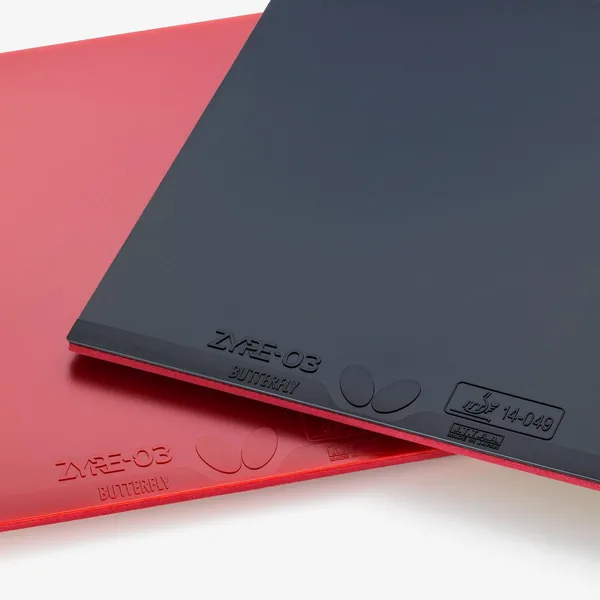

# Butterfly ZYRE-03

  

    

      
    

  

  

    

      
User rating

      <svg class="mg-radar" viewBox="0 0 320 280" role="img" aria-label="Butterfly ZYRE-03 community review radar chart from 31 reviews, scale 1 to 10: Overall 9.84, Speed 9.68, Spin 9.77, Control 8.55">
        <polygon class="mg-radar__ring" points="160.0,119.0 181.0,140.0 160.0,161.0 139.0,140.0"/>
        <polygon class="mg-radar__ring" points="160.0,98.0 202.0,140.0 160.0,182.0 118.0,140.0"/>
        <polygon class="mg-radar__ring" points="160.0,77.0 223.0,140.0 160.0,203.0 97.0,140.0"/>
        <polygon class="mg-radar__ring" points="160.0,56.0 244.0,140.0 160.0,224.0 76.0,140.0"/>
        <polygon class="mg-radar__ring mg-radar__ring--outer" points="160.0,35.0 265.0,140.0 160.0,245.0 55.0,140.0"/>
        <line class="mg-radar__spoke" x1="160" y1="140" x2="160.0" y2="35.0"/>
        <line class="mg-radar__spoke" x1="160" y1="140" x2="265.0" y2="140.0"/>
        <line class="mg-radar__spoke" x1="160" y1="140" x2="160.0" y2="245.0"/>
        <line class="mg-radar__spoke" x1="160" y1="140" x2="55.0" y2="140.0"/>
        <polygon class="mg-radar__area" points="160.0,36.7 261.6,140.0 160.0,242.6 70.2,140.0"/>
        <text class="mg-radar__axis" x="160" y="22" text-anchor="middle">Overall</text>
        <text class="mg-radar__axis" x="272" y="140" text-anchor="start">Speed</text>
        <text class="mg-radar__axis" x="160" y="260" text-anchor="middle">Spin</text>
        <text class="mg-radar__axis" x="48" y="140" text-anchor="end">Control</text>
        <text class="mg-radar__value" x="160" y="64" text-anchor="middle">9.84</text>
        <text class="mg-radar__value" x="236" y="140" text-anchor="middle">9.68</text>
        <text class="mg-radar__value" x="160" y="216" text-anchor="middle">9.77</text>
        <text class="mg-radar__value" x="84" y="140" text-anchor="middle">8.55</text>
      </svg>
    

    

      <a class="mg-home-hero__btn mg-home-hero__btn--primary" href="https://wa.me/8618627156285?text=Hello%2C%20I%27d%20like%20a%20quote%20for%20a%20brand-new%20Butterfly%20ZYRE-03%20rubber.%0D%0A%0D%0AShip%20to%20(city%20%2F%20postal%20code)%3A%0D%0A%0D%0A">Get this rubber quoted</a>
    

    
Also on the <a href="/rubbers/">Rubbers price table</a>.

  

## Overview

**Butterfly ZYRE-03** is the rubber with the highest ceiling in Butterfly's entire range, and it gets there the hard way. Its published ratings sit at the top of the lineup in every category that matters, and on the table it lives up to them — but only when your stroke is full enough to drive the ball deep into the sponge. The topsheet and the thick, hard sponge underneath are built to work as one piece, and that pairing only gives its best under a committed swing.

## Official specifications

Butterfly rates its rubbers on one scale across the whole range, and on that scale the ZYRE-03 is the new high point:

| Rating | ZYRE-03 | Standing |
| --- | --- | --- |
| Spin | 100 | highest in the lineup |
| Arc | 96 | highest in the lineup |
| Hardness | 44° | the hardest sponge Butterfly makes |
| Speed | 88 | second only to Dignics 64 (90) |

Read the four together and the character of the sheet is already there. Spin at 100 is the strongest marker Butterfly has published — there is no more spin on offer anywhere in the line. Arc at 96 is likewise the highest on the list: the ball leaves on a tall trajectory and kicks down hard off the second bounce. And 44° is the firmest sponge in the range, which is the source of both the rock-solid bottom-end support and the effort it asks for. Only speed trails anyone, and only Dignics 64: at 88 it still outruns Dignics 05 and the rest of the flagship field.

We stock the 2.5 and 2.7 mm sheets in red or black; the thickness-versus-hardness trade-off is covered in our [rubber guide](../guide/choosing-thickness-vs-hardness.md).

## Feel & break-in

The numbers are honest, but do not expect a familiar Dignics feel at first touch. Two things stand out over the first weeks:

- **The thick sponge reads as hollow out of the box.** Short pushes and light contact can feel floaty, as though the sheet is not quite holding the ball. That is an adjustment, not a flaw: thick sponge means gentle contact barely reaches the part of it that grips. A few sessions in, the same strokes start to feel crisp and connected.
- **It takes real power to give anything back.** Many players find the spin hard to unlock at first, for the same reason. Get the ball deep into the sponge — sound mechanics and a full, committed swing — and heavy, high-quality topspin comes easily, with the kind of bite that finishes points.

Passive play is the one place it punishes you: half-hearted strokes get noticeably less spin and speed than the same stroke would on a softer sheet, and precise short-game work needs a confident hand.

## Verdict

Purely as a performer, the ZYRE-03 is close to flawless — a genuine top-tier flagship with an extraordinarily high ceiling. It suits **advanced players who generate their own power** and want maximum spin with a high, heavy ball. Against the [Dignics 09C](dignics-09c.md) and the [Dignics 05](dignics-05.md) it is the hardest and the most demanding of the three, and the touring players who adopted it early, the [Harimoto siblings](/gear/harimoto-innerforce-alc/) among them, mostly run it on the backhand, where that firm sponge turns rally balls into winners.

The one real complaint is the price, and there is no way around it: this is the top of Butterfly's range. If your power generation is still developing, a Dignics or a Tenergy 05 will do more of the work for you — see [Why Play Tenergy Before Dignics?](../guide/why-tenergy-before-dignics.md). If you are choosing a blade to go with it, start from the classic outer-carbon [Viscaria](/gear/viscaria/) or Fan Zhendong's own [Fan Zhendong ALC](/gear/fan-zhendong-alc/).

  

    
Ready to get yours?

    
Check the live price table or request a quote via WhatsApp.

  

  

    <a class="mg-home-hero__btn mg-home-hero__btn--primary" href="https://wa.me/8618627156285?text=Hello%2C%20I%27d%20like%20a%20quote%20for%20a%20brand-new%20Butterfly%20ZYRE-03%20rubber.%0D%0A%0D%0AShip%20to%20(city%20%2F%20postal%20code)%3A%0D%0A%0D%0A">Request a quote on WhatsApp</a>
    <a class="mg-cta-card__outline" href="/rubbers/">Live price table</a>
  

## Frequently Asked Questions

### Does ZYRE-03 need boosting or tuning?

No. Like the rest of Butterfly's high-tension line, ZYRE-03 ships already tuned, and its topsheet and thick sponge are designed as one system. Boosting it is not recommended: the oil softens the sponge the topsheet was tuned to work with, so you add a little short-term liveliness at the cost of the structure you paid for.

### Is ZYRE-03 better on the forehand or the backhand?

On the backhand, for most of the players who use it. The touring players who adopted it early, the Harimoto siblings among them, mostly run it there, where the firm sponge turns rally balls into winners. It is strong enough for the forehand if your swing is full, but the backhand is where it is usually found.

### Can amateur players handle ZYRE-03?

It is the most demanding sheet in this family. Hit through the ball and it pays you back with heavy spin and speed; play a soft, half-hearted stroke and it does noticeably less for you, and its clean topsheet floats in the short game. Advanced amateurs with a full, committed swing handle it well; developing players are better off starting on a Dignics or a Tenergy 05.

## Ordering

For the latest price on this rubber, see the [Rubbers price list](../rubbers.md). We offer worldwide shipping — see [How to Order](../order.md).

!!! tip "Related"
    [Choosing Sponge Thickness vs Hardness](../guide/choosing-thickness-vs-hardness.md) · [Why Play Tenergy Before Dignics?](../guide/why-tenergy-before-dignics.md)

The content above is my personal opinion. If you spot an error or have a better suggestion, feel free to <a href="https://wa.me/8618627156285">message me on WhatsApp</a> — let's share better content with everyone together.

