<!-- 2026-10-27：整页换成 acebase.cc/blog/ 的资讯横排（用户：「将
     http://127.0.0.1:8001/guide/ 的样式 更换成https://acebase.cc/blog/ 的样式」）。
     问过之后定的两件事：**按日期从新到旧**（不再用入门阅读顺序；同一天仍按
     原来的阅读顺序排），**缩略图 16:9 裁切**（照 blog；源图有 4:3、2.36:1、
     竖图和方图，竖图上下裁得多，用户已确认）。

     同一天用户又说首屏那两行不要 ——「Table Tennis Guides / Blade construction,
     … newest first.」整块撤掉（大标题、黑线、导语一起），页面直接从第一条
     开始；这一页因此仍像以前一样没有 h1。日期 · 分类的小字保留在每条里。

     版式：一列横排条目 —— 左 16:9 缩略图（1fr），右标题、日期 · 分类小字、
     两三行摘要、Read more（1.9fr）。

     标记仍是 .mg-card 加 .mg-card--row，和首页 feed 同一套卡；没有
     .mg-card__zoom，所以 card-read-more.js 不收它们（摘要整段显示，不折叠），
     data-mg-clamp-fixed 随之撤掉。样式在 uncrate.css 第 13 节。

     本页由 _tmp_ocr/make_guide_hub.py 生成 —— 它先跑
     _tmp_ocr/extract_guide_entries.js，从 guide-grid.js 现抽 18 条 —— 手改会丢。

     2026-11-12 第三轮：列表下面又加了「Popular gear」货架（用户：「将 Popular
     gear 的内容都移到 http://127.0.0.1:8001/guide/」），即首页那条带整条搬来，
     见文末注释。**这一段不归 make_guide_hub.py 管**：它只重写 .mg-guide-hub 里的
     18 行，且那支脚本抽的是 guide-grid.js 现在的 12 条 /gear/ 评测（不是这 18
     篇文章），本身已经过期，别再跑它重生成整页。

     第四轮（同一天，用户：「将 http://127.0.0.1:8001/guide/ 的 Popular gear
     的排版和 <列表里的行卡> 等保持一致，且删除 Popular gear / 导语文字及分割
     符」）：货架的小标题、导语和上面那条 hairline 全删，12 张卡片换成和 18 条
     一样的横排卡，两段之间只剩列表的 16px 间距 —— 整页读起来是一张 30 条的连
     续列表。`data-mg-clamp-fixed` 和 `.mg-card__zoom` 随之撤掉：行卡摘要整段
     显示，不折叠（和上面 18 条一样）。
-->

  

    

      <article class="mg-card mg-card--row" id="rubber-lifespan-and-durability">
        

          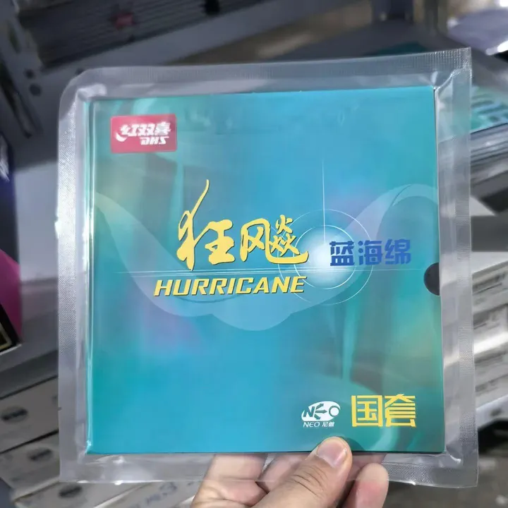
        

        

          <h2 class="mg-card__title"><a href="/guide/rubber-lifespan-and-durability/">How Long Rubbers Last</a></h2>
          
<time datetime="2026-09-14">14 Sep 2026</time> &middot; Rubbers

          
How long table tennis rubbers really last — a durability ranking of Chinese, Japanese and German sheets, blue vs orange sponge life, and what actually wears out.

          
<a href="/guide/rubber-lifespan-and-durability/">Read more</a>

        

      </article>

      <article class="mg-card mg-card--row" id="blade-thickness-and-flatness">
        

          
        

        

          <h2 class="mg-card__title"><a href="/guide/blade-thickness-and-flatness/">Blade Thickness, Penetration &amp; Flatness</a></h2>
          
<time datetime="2026-09-13">13 Sep 2026</time> &middot; Construction

          
How blade thickness changes penetration, spin and speed — measured figures for the Harimoto ALC, W968 and Stiga CL, plus what blade flatness means for consistency.

          
<a href="/guide/blade-thickness-and-flatness/">Read more</a>

        

      </article>

      <article class="mg-card mg-card--row" id="tibhar-darko-jorgic-infinity-carbon">
        

          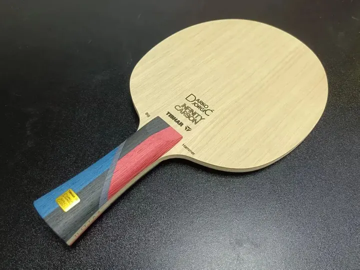
        

        

          <h2 class="mg-card__title"><a href="/guide/tibhar-darko-jorgic-infinity-carbon/">Tibhar Darko Jorgic Infinity Carbon Review</a></h2>
          
<time datetime="2026-08-30">30 Aug 2026</time> &middot; Review

          
An inner/outer aramid-carbon hybrid — the forehand feels like one blade, the backhand like another. Jorgic's and Li Hechen's blade, under review.

          
<a href="/guide/tibhar-darko-jorgic-infinity-carbon/">Read more</a>

        

      </article>

      <article class="mg-card mg-card--row" id="choosing-blade-structure">
        

          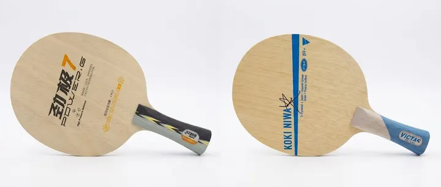
        

        

          <h2 class="mg-card__title"><a href="/guide/choosing-blade-structure/">How to Choose a Blade: All-Wood, Outer &amp; Inner Fiber</a></h2>
          
<time datetime="2026-08-26">26 Aug 2026</time> &middot; Construction

          
Where the fiber sits — above or below the strength ply, or nowhere at all — decides feel, speed, dwell, and who each structure suits.

          
<a href="/guide/choosing-blade-structure/">Read more</a>

        

      </article>

      <article class="mg-card mg-card--row" id="xu-xin-blue-label-vs-tibhar-felix">
        

          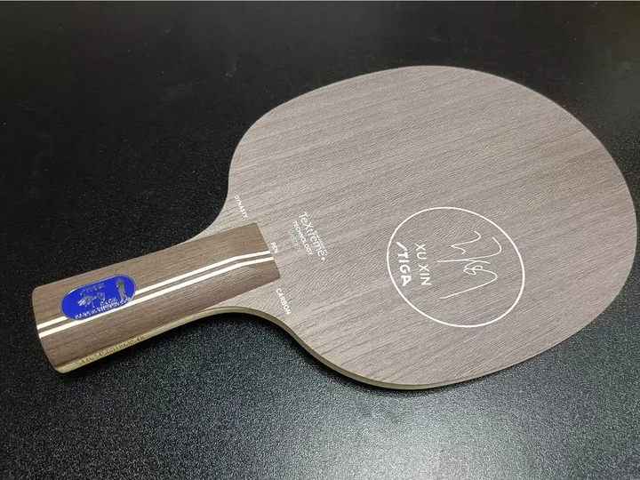
        

        

          <h2 class="mg-card__title"><a href="/guide/xu-xin-blue-label-vs-tibhar-felix/">Xu Xin Blue Label vs Tibhar Felix</a></h2>
          
<time datetime="2026-08-15">15 Aug 2026</time> &middot; Review

          
Two penhold blades compared — construction, player evaluation, and which one fits your game.

          
<a href="/guide/xu-xin-blue-label-vs-tibhar-felix/">Read more</a>

        

      </article>

      <article class="mg-card mg-card--row" id="joola-hugo-ary-c">
        

          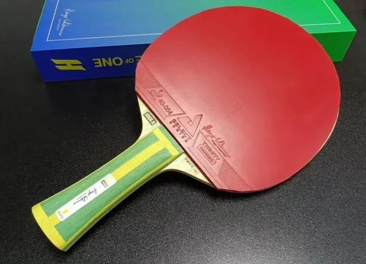
        

        

          <h2 class="mg-card__title"><a href="/guide/joola-hugo-ary-c/">Joola Hugo ARY-C Review</a></h2>
          
<time datetime="2026-08-05">5 Aug 2026</time> &middot; Review

          
A Korean-made inner green aramid-carbon blade — the balance, rigidity, and violence of the Hugo ARY-C.

          
<a href="/guide/joola-hugo-ary-c/">Read more</a>

        

      </article>

      <article class="mg-card mg-card--row" id="tt-kingdom-top-10-blades-2025">
        

          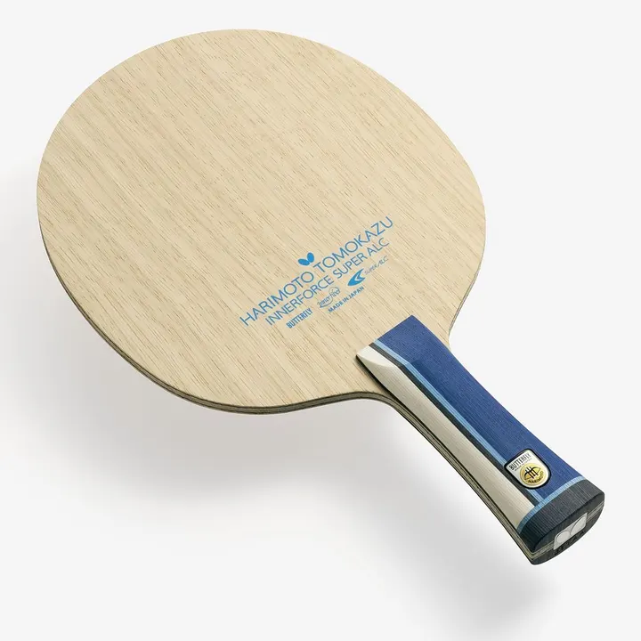
        

        

          <h2 class="mg-card__title"><a href="/guide/tt-kingdom-top-10-blades-2025/">Table Tennis Kingdom Top 10 Shakehand Blades 2025</a></h2>
          
<time datetime="2026-08-03">3 Aug 2026</time> &middot; Blades

          
Table Tennis Kingdom's 2025 top 10 shakehand blades — from Japan's leading table tennis magazine.

          
<a href="/guide/tt-kingdom-top-10-blades-2025/">Read more</a>

        

      </article>

      <article class="mg-card mg-card--row" id="blade-feel-fundamentals">
        

          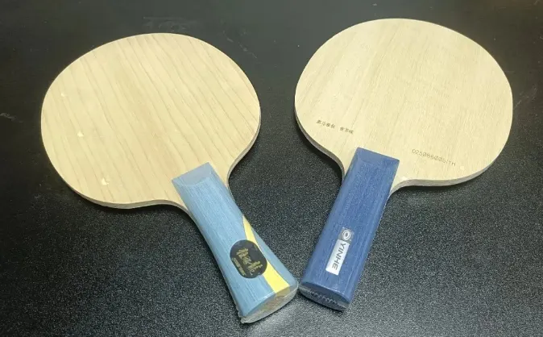
        

        

          <h2 class="mg-card__title"><a href="/guide/blade-feel-fundamentals/">Blade Feel Fundamentals</a></h2>
          
<time datetime="2026-07-22">22 Jul 2026</time> &middot; Feel

          
A practical buying guide for recreational players — how elasticity, hardness, and core wood shape the feel of a blade.

          
<a href="/guide/blade-feel-fundamentals/">Read more</a>

        

      </article>

      <article class="mg-card mg-card--row" id="blade-performance-metrics">
        

          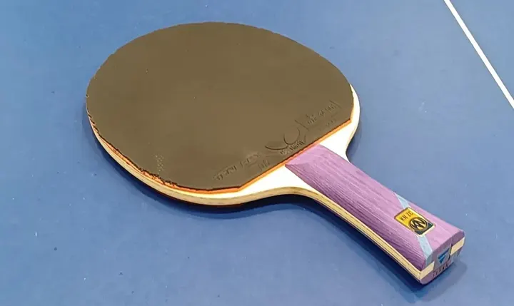
        

        

          <h2 class="mg-card__title"><a href="/guide/blade-performance-metrics/">Blade Performance Metrics</a></h2>
          
<time datetime="2026-07-22">22 Jul 2026</time> &middot; Performance

          
When you shop for a blade, brand and looks matter less than the playing qualities underneath — six metrics that decide how a blade really plays.

          
<a href="/guide/blade-performance-metrics/">Read more</a>

        

      </article>

      <article class="mg-card mg-card--row" id="outer-vs-inner-fiber">
        

          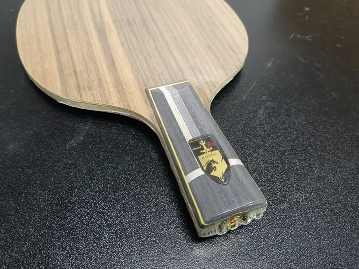
        

        

          <h2 class="mg-card__title"><a href="/guide/outer-vs-inner-fiber/">Outer vs Inner Fiber</a></h2>
          
<time datetime="2026-07-20">20 Jul 2026</time> &middot; Construction

          
A blade is at least 85% wood. Where the fiber sits — outer or inner — changes the feel and arc more than the fiber itself.

          
<a href="/guide/outer-vs-inner-fiber/">Read more</a>

        

      </article>

      <article class="mg-card mg-card--row" id="essential-questions-before-buying">
        

          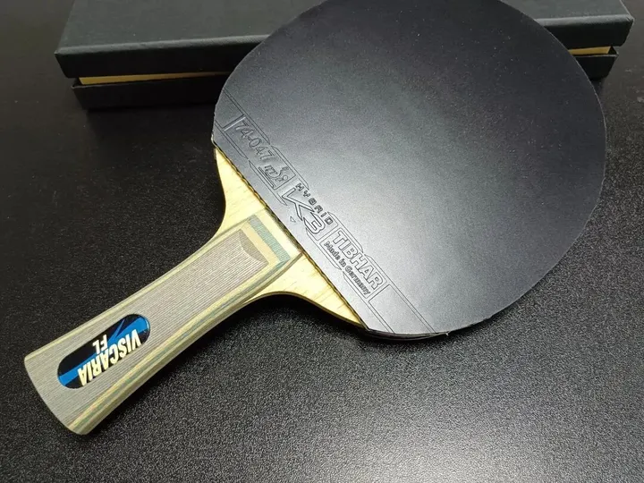
        

        

          <h2 class="mg-card__title"><a href="/guide/essential-questions-before-buying/">Essential Questions Before Buying</a></h2>
          
<time datetime="2026-07-14">14 Jul 2026</time> &middot; Buying

          
A beginner-friendly checklist. Before you chase brand names, check six basics: weight, balance, face size, thickness, outer ply, and construction.

          
<a href="/guide/essential-questions-before-buying/">Read more</a>

        

      </article>

      <article class="mg-card mg-card--row" id="accelerating-with-gear">
        

          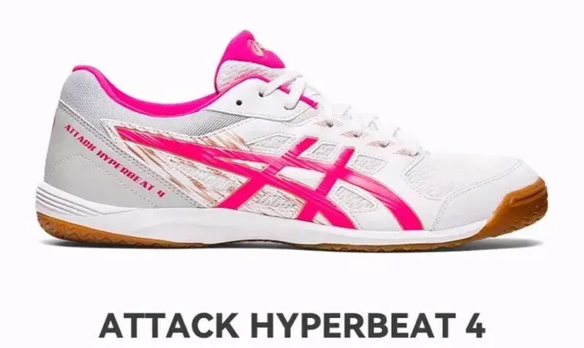
        

        

          <h2 class="mg-card__title"><a href="/guide/accelerating-with-gear/">Accelerating With Gear</a></h2>
          
<time datetime="2026-07-14">14 Jul 2026</time> &middot; Technique

          
Acceleration is first a technique story — better footwork, earlier reads, looser hands — then a gear question.

          
<a href="/guide/accelerating-with-gear/">Read more</a>

        

      </article>

      <article class="mg-card mg-card--row" id="harimoto-szlc-vs-salc">
        

          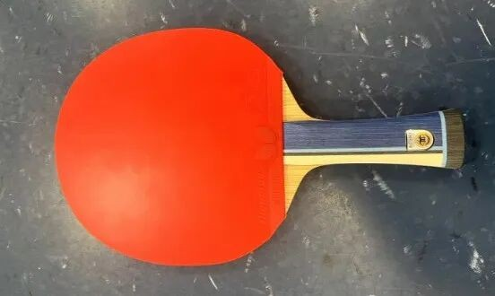
        

        

          <h2 class="mg-card__title"><a href="/guide/harimoto-szlc-vs-salc/">Harimoto SZLC vs SALC</a></h2>
          
<time datetime="2026-07-14">14 Jul 2026</time> &middot; Comparison

          
Two Butterfly “Super Harimoto” inner blades look almost identical on paper — this breaks down where they really differ.

          
<a href="/guide/harimoto-szlc-vs-salc/">Read more</a>

        

      </article>

      <article class="mg-card mg-card--row" id="why-tenergy-before-dignics">
        

          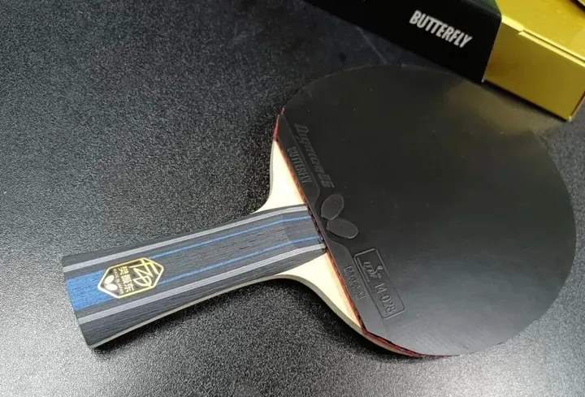
        

        

          <h2 class="mg-card__title"><a href="/guide/why-tenergy-before-dignics/">Why Tenergy Before Dignics</a></h2>
          
<time datetime="2026-07-14">14 Jul 2026</time> &middot; Rubbers

          
Many Butterfly stars eventually land on Dignics — yet most of them still pass through Tenergy first.

          
<a href="/guide/why-tenergy-before-dignics/">Read more</a>

        

      </article>

      <article class="mg-card mg-card--row" id="hurricane-blue-vs-orange-sponge">
        

          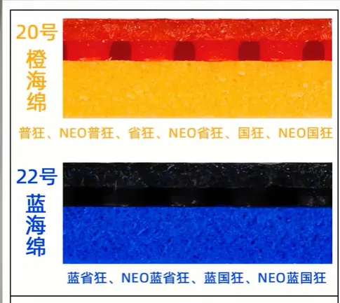
        

        

          <h2 class="mg-card__title"><a href="/guide/hurricane-blue-vs-orange-sponge/">Hurricane Blue vs Orange Sponge</a></h2>
          
<time datetime="2026-07-14">14 Jul 2026</time> &middot; Rubbers

          
For amateurs, H3 sponge choice is not a color preference — it is matching the sponge to your technique.

          
<a href="/guide/hurricane-blue-vs-orange-sponge/">Read more</a>

        

      </article>

      <article class="mg-card mg-card--row" id="choosing-thickness-vs-hardness">
        

          
        

        

          <h2 class="mg-card__title"><a href="/guide/choosing-thickness-vs-hardness/">Rubber Thickness vs Hardness</a></h2>
          
<time datetime="2026-07-14">14 Jul 2026</time> &middot; Rubbers

          
Classic provincial Hurricane 3 examples — how thickness and hardness interact inside the H3 family.

          
<a href="/guide/choosing-thickness-vs-hardness/">Read more</a>

        

      </article>

      <article class="mg-card mg-card--row" id="hurricane-3-multi-stage-boosting">
        

          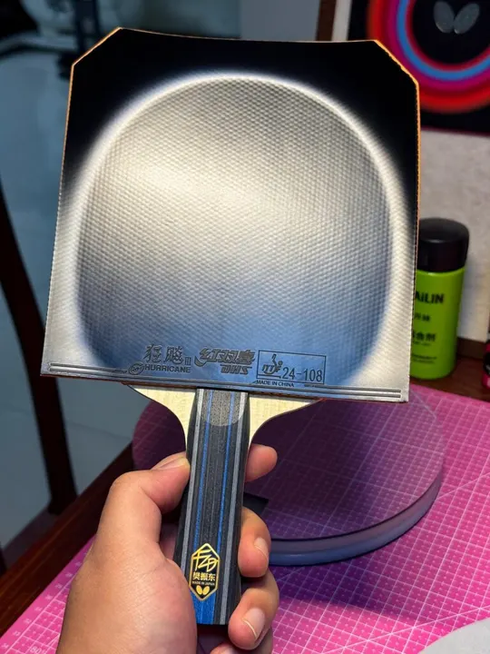
        

        

          <h2 class="mg-card__title"><a href="/guide/hurricane-3-multi-stage-boosting/">Hurricane 3 Multi-Stage Boosting</a></h2>
          
<time datetime="2026-07-14">14 Jul 2026</time> &middot; Boosting

          
Five thin stages to a transparent, lively H3 sponge: open it, soften it deep, lock it with glue, then give it a final charge.

          
<a href="/guide/hurricane-3-multi-stage-boosting/">Read more</a>

        

      </article>

      <article class="mg-card mg-card--row" id="boosting-truth">
        

          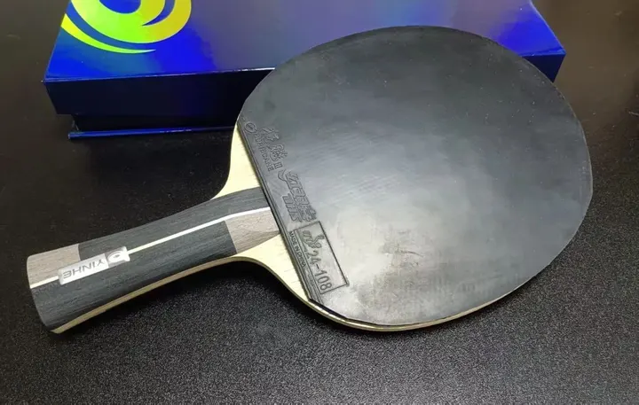
        

        

          <h2 class="mg-card__title"><a href="/guide/boosting-truth/">Boosting Truth</a></h2>
          
<time datetime="2026-07-14">14 Jul 2026</time> &middot; Boosting

          
Boosting is not a moral absolute — it is a tool for opening the sponge and adding spring. Here is when you actually need it.

          
<a href="/guide/boosting-truth/">Read more</a>

        

      </article>

    

  

<!-- 2026-11-12, third and fourth turns.

     Third (user: 「将Popular gear的内容都移到 http://127.0.0.1:8001/guide/」):
     the twelve /gear/ product reviews the same day had put in a band under
     "Popular setups" on the home page moved here, feed furniture and all.
     Fourth, the same day (user: 「将 http://127.0.0.1:8001/guide/ 的 Popular
     gear 的排版和 <列表里的行卡> 等保持一致，且删除Popular gear / 导语文字及
     分割符」): the shelf's own heading, its lead line and the hairline above it
     are gone, and guide-grid.js draws its cards with the articles' row recipe
     (.mg-card--row), so the page is one list of thirty rows — the twelve shop
     reviews carrying on from the eighteen articles at the same 16px rhythm.

     What is left of a wrapper stands only because the lazy feed needs one: the
     grid guide-grid.js appends to, the sentinel it watches, the status line and
     the no-JS list. It stays outside .mg-guide-hub so that wrapper keeps
     meaning "the eighteen articles". -->
<section class="mg-guide-gear" id="popular-gear" markdown="0">

  

  

    

    
Loading more&hellip;

    <noscript>
      <ul>
        <li><a href="/gear/dignics-09c/">Butterfly Dignics 09C Review, Price &amp; Specs</a></li>
        <li><a href="/gear/fan-zhendong-alc/">Butterfly Fan Zhendong ALC Review, Price &amp; Specs</a></li>
        <li><a href="/gear/zhang-jike-alc/">Butterfly Zhang Jike ALC Review, Price &amp; Specs</a></li>
        <li><a href="/gear/ovtcharov-innerforce-alc/">Butterfly Ovtcharov Innerforce ALC Review, Price &amp; Specs</a></li>
        <li><a href="/gear/viscaria/">Butterfly Viscaria Review, Price &amp; Specs</a></li>
        <li><a href="/gear/timo-boll-alc/">Butterfly Timo Boll ALC Review, Price &amp; Specs</a></li>
        <li><a href="/gear/harimoto-innerforce-alc/">Butterfly Harimoto Innerforce ALC Review, Price &amp; Specs</a></li>
        <li><a href="/gear/dhs-hurricane-long-5/">DHS Hurricane Long 5 Review, Price &amp; Specs</a></li>
        <li><a href="/gear/victas-koki-niwa/">Victas Koki Niwa Review, Price &amp; Specs</a></li>
        <li><a href="/gear/zyre-03/">Butterfly ZYRE-03 Review, Price &amp; Specs</a></li>
        <li><a href="/gear/tenergy-05/">Butterfly Tenergy 05 Review, Price &amp; Specs</a></li>
        <li><a href="/gear/dignics-05/">Butterfly Dignics 05 Review, Price &amp; Specs</a></li>
      </ul>
    </noscript>

  

</section>
