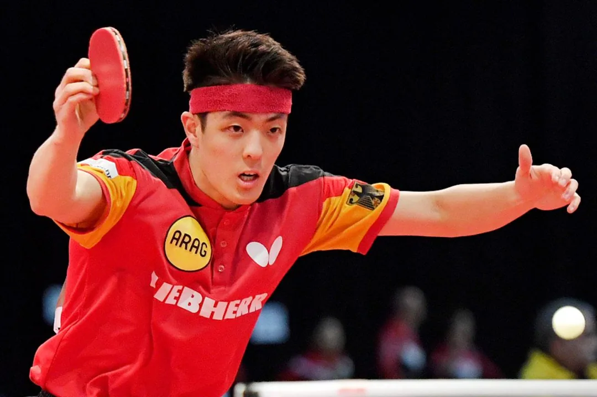

<!-- The site's home since 2026-11-09 (user: 「将ETC改为Home,并移到最前面」).

     It was /etc/ before that, rebuilt on acebase.cc's homepage layout the same
     day (user: 「将 http://127.0.0.1:8001/etc/ 模仿
     http://127.0.0.1:8003/页面进行更新，将现有ETC商品移至Popular gear中」), and
     the old home page — the players' setups — took over /setups/. The page is
     four bands: a gradient hero with the link box, the three-step journey card
     lifted over its foot, four catalogue banners, and the grey "Popular
     add-ons" band that holds the fourteen accessories behind category pills —
     add-ons, not the catalogue: the blades and rubbers have pages of their own
     (user: 「这里要表达的是热门加购的一些附件，因为常见的底板和胶皮已经在…页面
     展示了」), and the lead says only that these are what players most often
     add to an order (user: 「要表达是大家在订单中经常添加的」; the sentence
     about blades/rubbers having their own pages was cut the same turn). The
     banners are what makes this a front door rather than a category page: the
     blades, rubbers, pre-owned stock and the players' setups all sit one click
     away (the fourth banner was Guides until 2026-11-09, user: 「中的 Reading
     Guides 换成 /setups/ 页面」).

     2026-11-12 (user: 「将Popular add-ons的商品以 add-ons类目放置在 Pre-owned
     之后，将setups的内容移至原来的 Popular add-ons，并更名为 热门配置（英文）」):
     the accessories left the page. They are a catalogue of their own now, on
     /add-ons/ behind the fifth banner, which sits after Pre-owned — five
     banners in all. The grey band at the foot of the page keeps its slot and
     its id (`gear`, which the first chip and the search box scroll to) and
     holds the players' setups instead, renamed "Popular setups": the same
     fourteen cards /setups/ carries, copied whole, so a change to one of them
     has to be made in both files. The band's category pills and the shelf
     search went with the accessories — the link box still hands a link to
     WhatsApp, but a plain word now only scrolls the page down.

     The same day, a second turn: the twelve /gear/ reviews left /setups/ for
     a band of their own under the setups, "Popular gear" (user: 「原来的
     setups页的其它内容可以移到首页的Popular setups下面再建立一个 热门装备
     （英文）」).

     A third turn took that band off the page: the user had it all moved to
     /guide/ (「将Popular gear的内容都移到 http://127.0.0.1:8001/guide/」),
     heading, lead, cards and feed together. The page ends on one shelf again —
     grey "Popular setups" — and /setups/, at that point, still its fourteen
     player cards alone (the next paragraph takes even that away).

     And a fourth, the same day: the page itself went (「删除
     http://127.0.0.1:8001/setups/」) — nav entry, fifth banner and the three
     redirect stubs that pointed at it too, so /setups/ and the older names
     that led there are 404 now, as this site leaves every retired address.
     The grey band below is the only place the fourteen player cards live; the
     sentence above about changing a card in both files is history.

     The hero art is /images/home-hero/hero-dalu.webp, cut by
     _tmp_ocr/hero_art_prep.py (which records every source and its crop box)
     from the phone still the user supplied that day (user: 「换成这张试试」):
     the unassembled racket on its cutting mat — blade, rubber, glue, sponge,
     cutter — cropped to the art slot's 1.30 ratio. It replaced hero.webp, the
     Gemini banner crop from earlier the same day (user: 「页面中的背景图需要
     换成这一张」), which is still in the folder if this one is rejected.

     The hero's meta line names the three things the shop does. It read
     "Send a product link · I quote it in USD · I buy and assemble it for you"
     until 2026-11-12, when the user rewrote it (「发送一个产品链接或名称，我为你
     以美元报价，并提供组装和全球配送服务」): a link *or a name* can start the
     chat, and the promise is assembly plus worldwide shipping rather than
     buying. Assembling — gluing the rubbers onto the blade — is promised up
     front, not only in the ordering page, and the
     hero speaks as one person: this is a one-man shop, so it is "I", not
     "we", here and in the journey card under it (user: 「不要说我们，说我就
     行了」). Shipping moved to step 3, which now says "I buy the piece,
     assemble it and ship it to your door". Step 1 sends a link to something
     the shop does not stock (user: 「粘贴你想要买且我的店铺中没有的装备
     链接」), not "any product link, or pick a piece from the shelf" — the
     shelf underneath already sells what it has.

     The layout came from acebase.cc, but the hero's job did not stay there:
     this shop is a China proxy-buying service too (user: 「应该表达的是为用户
     提供从中国代购服务，而输入框应该是用户输入商品链接后，点击获取价格后，
     打开whatsapp聊天」), so a pasted product link + Get price opens WhatsApp
     with the link already in the message, and a plain word narrows the shelf
     below instead. The cards keep the shop's price and cart button, and the
     order itself still goes through WhatsApp. See
     docs/stylesheets/home-superbuy.css for the measured geometry and
     docs/javascripts/home-sb.js for the box and the pills.

     Every data-name and data-price is the string it was on the old grid, so a
     cart saved before the rebuild still matches its lines. The Qilin shoe
     keeps the title and photos its last edit gave it on 2026-11-07; the five
     frames are still 02, 04, 05, 06 and 07, with 02 as the cover. -->

  <section class="mg-sb-hero">
    

      
    

    

      

        <h1 class="mg-sb-hero__title">Table tennis gear, bought from China for you</h1>
        
Send a product link or name &middot; I quote it in USD &middot; I assemble it and ship it worldwide

        <form class="mg-sb-search" id="home-search-form" role="search">
          <label class="mg-sb-search__field">
            <svg class="mg-sb-search__icon" viewBox="0 0 24 24" width="18" height="18" aria-hidden="true" focusable="false">
              <circle cx="11" cy="11" r="6.5" fill="none" stroke="currentColor" stroke-width="2"/>
              <path d="m16 16 5 5" fill="none" stroke="currentColor" stroke-width="2" stroke-linecap="round"/>
            </svg>
            <input type="text" id="home-search" name="q" autocomplete="off" placeholder="Paste an Amazon, AliExpress or any store link" aria-label="Paste a product link for a sourcing price">
          </label>
          <button class="mg-sb-search__submit" type="submit">Get price</button>
        </form>
        

        

          <a class="mg-sb-chip" href="#gear">Popular setups</a>
          <a class="mg-sb-chip" href="#how">How sourcing works</a>
          <a class="mg-sb-chip" href="https://wa.me/8618627156285?text=Hello%2C%20I%27d%20like%20a%20quote%20for%20table%20tennis%20gear.%0D%0A%0D%0AShip%20to%20(city%20%2F%20postal%20code)%3A%0D%0A%0D%0A">Chat on WhatsApp</a>
        

      

    

  </section>

  <section class="mg-sb-journey" id="how">
    

      

        <ol class="mg-sb-journey__steps">
          <li class="mg-sb-step">
            
1 Send a link

            
Paste a link to gear you want that my shop doesn't carry.

          </li>
          <li class="mg-sb-step">
            
2 I quote it in USD

            
One price for the item and its shipping — I buy it in China for you.

          </li>
          <li class="mg-sb-step">
            
3 Confirm on WhatsApp

            
Pay in the chat; I buy the piece, assemble it and ship it to your door — see <a href="/order/">How to Order</a>.

          </li>
        </ol>
        

          
          
          
        

      

    

  </section>

  <section class="mg-sb-features">
    

      

        <a class="mg-sb-feature mg-sb-feature--blades" href="/blades/">
          
            Catalogue
            Blades
          
          <svg viewBox="0 0 24 24" width="18" height="18" aria-hidden="true" focusable="false"><path d="M5 12h13M13 6l6 6-6 6" fill="none" stroke="currentColor" stroke-width="2.2" stroke-linecap="round" stroke-linejoin="round"/></svg>
        </a>
        <a class="mg-sb-feature mg-sb-feature--rubbers" href="/rubbers/">
          
            Catalogue
            Rubbers
          
          <svg viewBox="0 0 24 24" width="18" height="18" aria-hidden="true" focusable="false"><path d="M5 12h13M13 6l6 6-6 6" fill="none" stroke="currentColor" stroke-width="2.2" stroke-linecap="round" stroke-linejoin="round"/></svg>
        </a>
        <a class="mg-sb-feature mg-sb-feature--preowned" href="/pre-owned/">
          
            Catalogue
            Pre-owned
          
          <svg viewBox="0 0 24 24" width="18" height="18" aria-hidden="true" focusable="false"><path d="M5 12h13M13 6l6 6-6 6" fill="none" stroke="currentColor" stroke-width="2.2" stroke-linecap="round" stroke-linejoin="round"/></svg>
        </a>
        <a class="mg-sb-feature mg-sb-feature--addons" href="/add-ons/">
          
            Catalogue
            Add-ons
          
          <svg viewBox="0 0 24 24" width="18" height="18" aria-hidden="true" focusable="false"><path d="M5 12h13M13 6l6 6-6 6" fill="none" stroke="currentColor" stroke-width="2.2" stroke-linecap="round" stroke-linejoin="round"/></svg>
        </a>
      

    

  </section>

  <section class="mg-sb-discovery" id="gear">
    

      <header class="mg-sb-discovery__head">
        <h2 class="mg-sb-discovery__title">Popular setups</h2>
        <a class="mg-sb-chat" href="https://wa.me/8618627156285?text=Hello%2C%20I%27d%20like%20advice%20on%20a%20player%27s%20setup.%0D%0A%0D%0AShip%20to%20(city%20%2F%20postal%20code)%3A%0D%0A%0D%0A">Open live chat</a>
      </header>

      <!-- The fourteen player cards (user, 2026-11-12: 「将setups的内容
           移至原来的 Popular add-ons，并更名 为 热门配置（英文）」). They were
           copies of /setups/ until the user deleted that page the same day
           (「删除 http://127.0.0.1:8001/setups/」) — these are the cards' only
           home now, so a new player setup is added here and nowhere else.
           What survives from the copy is the geometry: `sizes` names the
           band's 389px card (three a row, see home-superbuy.css) and the
           titles are h3s, because this band's own h2 covers them.

           The lead line under the title went the same day (user: 「The blades
           and rubbers today's top players actually use — every line priced,
           and one tap opens the chat with the whole setup in the message.」
           去掉): the title now goes straight to the cards. `.mg-sb-discovery__lead`
           stays in home-superbuy.css, unused. -->
      

  <article class="mg-card mg-card--player">
    

      
    

    
      <h3 class="mg-card__title">Sora Matsushima's setup</h3>
      

        Butterfly Fan Zhendong ALC / $159
        Butterfly Dignics 09C / $73
        Butterfly ZYRE-03 / $89
      

      

        <a class="mg-card__ask" href="https://wa.me/8618627156285?text=Hi%2C%20I%27d%20like%20a%20quote%20for%20a%20Fan%20Zhendong%20ALC%20with%20Dignics%2009C%20and%20ZYRE-03.%0D%0A%0D%0AShip%20to%20(city%20%2F%20postal%20code)%3A%0D%0A%0D%0A" target="_blank" rel="noopener noreferrer">Ask about this setup</a>
      

    

  </article>

  <article class="mg-card mg-card--player">
    

      
    

    
      <h3 class="mg-card__title">Wang Chuqin's setup</h3>
      

        DHS Q968 / $320
        DHS Hurricane 3 National / $50
        DHS Hurricane 8 / $28
      

      

        <a class="mg-card__ask" href="https://wa.me/8618627156285?text=Hi%2C%20I%27d%20like%20a%20quote%20for%20a%20DHS%20Q968%20with%20Hurricane%203%20National%20blue%20sponge%20and%20Hurricane%208.%0D%0A%0D%0AShip%20to%20(city%20%2F%20postal%20code)%3A%0D%0A%0D%0A" target="_blank" rel="noopener noreferrer">Ask about this setup</a>
      

    

  </article>

  <article class="mg-card mg-card--player">
    

      
    

    
      <h3 class="mg-card__title">Tomokazu Harimoto's setup</h3>
      

        Butterfly Harimoto Innerforce Super ALC / $168
        Butterfly ZYRE-03 · Both Sides / $89
      

      

        <a class="mg-card__ask" href="https://wa.me/8618627156285?text=Hi%2C%20I%27d%20like%20a%20quote%20for%20a%20Harimoto%20Innerforce%20Super%20ALC%20with%20ZYRE-03%20on%20both%20sides.%0D%0A%0D%0AShip%20to%20(city%20%2F%20postal%20code)%3A%0D%0A%0D%0A" target="_blank" rel="noopener noreferrer">Ask about this setup</a>
      

    

  </article>

  <article class="mg-card mg-card--player">
    

      
    

    
      <h3 class="mg-card__title">Dang Qiu's setup</h3>
      

        Butterfly Timo Boll ALC / $133
        Butterfly Dignics 09C · Both Sides / $73
      

      

        <a class="mg-card__ask" href="https://wa.me/8618627156285?text=Hi%2C%20I%27d%20like%20a%20quote%20for%20a%20Dignics%2009C%20on%20both%20sides%20of%20a%20penhold%20blade.%0D%0A%0D%0AShip%20to%20(city%20%2F%20postal%20code)%3A%0D%0A%0D%0A" target="_blank" rel="noopener noreferrer">Ask about this setup</a>
      

    

  </article>

  <article class="mg-card mg-card--player">
    

      
    

    
      <h3 class="mg-card__title">Patrick Franziska's setup</h3>
      

        Butterfly Franziska Innerforce ZLC / $216
        Butterfly ZYRE-03 / $89
        Butterfly Dignics 09C / $73
      

      

        <a class="mg-card__ask" href="https://wa.me/8618627156285?text=Hi%2C%20I%27d%20like%20a%20quote%20for%20a%20Franziska%20Innerforce%20ZLC%20with%20ZYRE-03%20on%20the%20forehand%20and%20Dignics%2009C%20on%20the%20backhand.%0D%0A%0D%0AShip%20to%20(city%20%2F%20postal%20code)%3A%0D%0A%0D%0A" target="_blank" rel="noopener noreferrer">Ask about this setup</a>
      

    

  </article>

  <article class="mg-card mg-card--player">
    

      
    

    
      <h3 class="mg-card__title">Félix Lebrun's setup</h3>
      

        Tibhar Félix Lebrun Hyper Carbon / $139
        Tibhar Hybrid K3 Pro · Both Sides / $59
      

      

        <a class="mg-card__ask" href="https://wa.me/8618627156285?text=Hi%2C%20I%27d%20like%20a%20quote%20for%20a%20Felix%20Lebrun%20Hyper%20Carbon%20with%20Hybrid%20K3%20Pro%20on%20both%20sides.%0D%0A%0D%0AShip%20to%20(city%20%2F%20postal%20code)%3A%0D%0A%0D%0A" target="_blank" rel="noopener noreferrer">Ask about this setup</a>
      

    

  </article>

  <article class="mg-card mg-card--player">
    

      
    

    
      <h3 class="mg-card__title">Lin Yun-Ju's setup</h3>
      

        Butterfly Viscaria Super ALC / $208
        Butterfly ZYRE-03 / $89
        Butterfly Dignics 05 / $68
      

      

        <a class="mg-card__ask" href="https://wa.me/8618627156285?text=Hi%2C%20I%27d%20like%20a%20quote%20for%20a%20Viscaria%20Super%20ALC%20with%20ZYRE-03%20on%20the%20forehand%20and%20Dignics%2005%20on%20the%20backhand.%0D%0A%0D%0AShip%20to%20(city%20%2F%20postal%20code)%3A%0D%0A%0D%0A" target="_blank" rel="noopener noreferrer">Ask about this setup</a>
      

    

  </article>

  <article class="mg-card mg-card--player">
    

      
    

    
      <h3 class="mg-card__title">Truls Möregårdh's setup</h3>
      

        STIGA Cybershape Carbon / $232
        STIGA Helix Platinum XH · Both Sides / $65
      

      

        <a class="mg-card__ask" href="https://wa.me/8618627156285?text=Hi%2C%20I%27d%20like%20a%20quote%20for%20a%20Cybershape%20Carbon%20with%20Helix%20Platinum%20XH%20on%20both%20sides.%0D%0A%0D%0AShip%20to%20(city%20%2F%20postal%20code)%3A%0D%0A%0D%0A" target="_blank" rel="noopener noreferrer">Ask about this setup</a>
      

    

  </article>

  <article class="mg-card mg-card--player">
    

      
    

    
      <h3 class="mg-card__title">Hugo Calderano's setup</h3>
      

        XIOM Hugo Hyper Axylium / Price on request
        Joola Trinity Charged / $62
        Joola Trinity Dynamic / $62
      

      

        <a class="mg-card__ask" href="https://wa.me/8618627156285?text=Hi%2C%20I%27d%20like%20a%20quote%20for%20a%20Hyper%20Axylium%20with%20Trinity%20Charged%20on%20the%20forehand%20and%20Trinity%20Dynamic%20on%20the%20backhand.%0D%0A%0D%0AShip%20to%20(city%20%2F%20postal%20code)%3A%0D%0A%0D%0A" target="_blank" rel="noopener noreferrer">Ask about this setup</a>
      

    

  </article>

  <article class="mg-card mg-card--player">
    

      
    

    
      <h3 class="mg-card__title">Lin Shidong's setup</h3>
      

        Butterfly Viscaria Golden / Price on request
        DHS Hurricane 3 Neo / $23
        Butterfly Dignics 09C / $73
      

      

        <a class="mg-card__ask" href="https://wa.me/8618627156285?text=Hi%2C%20I%27d%20like%20a%20quote%20for%20a%20Viscaria%20with%20Hurricane%203%20Neo%20on%20the%20forehand%20and%20Dignics%2009C%20on%20the%20backhand.%0D%0A%0D%0AShip%20to%20(city%20%2F%20postal%20code)%3A%0D%0A%0D%0A" target="_blank" rel="noopener noreferrer">Ask about this setup</a>
      

    

  </article>

  <article class="mg-card mg-card--player">
    

      
    

    
      <h3 class="mg-card__title">Fan Zhendong's setup</h3>
      

        Butterfly Fan Zhendong ALC / $159
        DHS Hurricane 3 National / $50
        Butterfly Dignics 09C / $73
      

      

        <a class="mg-card__ask" href="https://wa.me/8618627156285?text=Hi%2C%20I%27d%20like%20a%20quote%20for%20a%20Fan%20Zhendong%20ALC%20with%20Hurricane%203%20National%20on%20the%20forehand%20and%20Dignics%2009C%20on%20the%20backhand.%0D%0A%0D%0AShip%20to%20(city%20%2F%20postal%20code)%3A%0D%0A%0D%0A" target="_blank" rel="noopener noreferrer">Ask about this setup</a>
      

    

  </article>

  <article class="mg-card mg-card--player">
    

      
    

    
      <h3 class="mg-card__title">Zhou Qihao's setup</h3>
      

        Double Fish Zhou Qihao Project Z / Price on request
        DHS Neo Hurricane 3 National / $50
        Butterfly Dignics 09C / $73
      

      

        <a class="mg-card__ask" href="https://wa.me/8618627156285?text=Hi%2C%20I%27d%20like%20a%20quote%20for%20a%20Zhou%20Qihao%20Project%20Z%20with%20Neo%20Hurricane%203%20National%20on%20the%20forehand%20and%20Dignics%2009C%20on%20the%20backhand.%0D%0A%0D%0AShip%20to%20(city%20%2F%20postal%20code)%3A%0D%0A%0D%0A" target="_blank" rel="noopener noreferrer">Ask about this setup</a>
      

    

  </article>

  <article class="mg-card mg-card--player">
    

      
    

    
      <h3 class="mg-card__title">Wen Ruibo's setup</h3>
      

        Stiga Luma Hybrid Carbon / Price on request
        DHS Neo Hurricane 3 National / $50
        Stiga DNA Hybrid XH / Price on request
      

      

        <a class="mg-card__ask" href="https://wa.me/8618627156285?text=Hi%2C%20I%27d%20like%20a%20quote%20for%20a%20Stiga%20Luma%20Hybrid%20Carbon%20with%20Neo%20Hurricane%203%20National%20on%20the%20forehand%20and%20DNA%20Hybrid%20XH%20on%20the%20backhand.%0D%0A%0D%0AShip%20to%20(city%20%2F%20postal%20code)%3A%0D%0A%0D%0A" target="_blank" rel="noopener noreferrer">Ask about this setup</a>
      

    

  </article>

  <article class="mg-card mg-card--player">
    

      
    

    
      <h3 class="mg-card__title">Li Tianyang's setup</h3>
      

        DHS Classic 08X / $50
        DHS Neo Hurricane 3 National / $50
        Friendship 729 802-40 / $19
      

      

        <a class="mg-card__ask" href="https://wa.me/8618627156285?text=Hi%2C%20I%27d%20like%20a%20quote%20for%20a%20DHS%20Classic%2008X%20with%20Neo%20Hurricane%203%20National%20on%20the%20forehand%20and%20Friendship%20729%20802-40%20on%20the%20backhand.%0D%0A%0D%0AShip%20to%20(city%20%2F%20postal%20code)%3A%0D%0A%0D%0A" target="_blank" rel="noopener noreferrer">Ask about this setup</a>
      

    

  </article>

      

    

  </section>

