<!-- The site's home since 2026-11-09 (user: 「将ETC改为Home,并移到最前面」).

     It was /etc/ before that, rebuilt on acebase.cc's homepage layout the same
     day (user: 「将 http://127.0.0.1:8001/etc/ 模仿
     http://127.0.0.1:8003/页面进行更新，将现有ETC商品移至Popular gear中」), and
     the old home page — the players' setups — took over /setups/. The page is
     four bands: a gradient hero with the link box, the three-step journey card
     lifted over its foot, four catalogue banners, and the grey "Popular
     add-ons" band that holds the fourteen accessories behind category pills —
     add-ons, not the catalogue: the blades and rubbers have pages of their own
     (user: 「这里要表达的是热门加购的一些附件，因为常见的底板和胶皮已经在…页面
     展示了」), and the lead says only that these are what players most often
     add to an order (user: 「要表达是大家在订单中经常添加的」; the sentence
     about blades/rubbers having their own pages was cut the same turn). The
     banners are what makes this a front door rather than a category page: the
     blades, rubbers, pre-owned stock and the players' setups all sit one click
     away (the fourth banner was Guides until 2026-11-09, user: 「中的 Reading
     Guides 换成 /setups/ 页面」).

     The hero art is /images/home-hero/hero-dalu.webp, cut by
     _tmp_ocr/hero_art_prep.py (which records every source and its crop box)
     from the phone still the user supplied that day (user: 「换成这张试试」):
     the unassembled racket on its cutting mat — blade, rubber, glue, sponge,
     cutter — cropped to the art slot's 1.30 ratio. It replaced hero.webp, the
     Gemini banner crop from earlier the same day (user: 「页面中的背景图需要
     换成这一张」), which is still in the folder if this one is rejected.

     The hero's meta line names the three things the shop does (user,
     2026-11-09: 「发送商品链接，我为你以美元报价，为你组装并发货」, then
     「我为你采购并组装」): "Send a product link · I quote it in USD · I buy
     and assemble it for you". Buying and assembling — gluing the rubbers onto
     the blade — are promised up front, not only in the ordering page, and the
     hero speaks as one person: this is a one-man shop, so it is "I", not
     "we", here and in the journey card under it (user: 「不要说我们，说我就
     行了」). Shipping moved to step 3, which now says "I buy the piece,
     assemble it and ship it to your door". Step 1 sends a link to something
     the shop does not stock (user: 「粘贴你想要买且我的店铺中没有的装备
     链接」), not "any product link, or pick a piece from the shelf" — the
     shelf underneath already sells what it has.

     The layout came from acebase.cc, but the hero's job did not stay there:
     this shop is a China proxy-buying service too (user: 「应该表达的是为用户
     提供从中国代购服务，而输入框应该是用户输入商品链接后，点击获取价格后，
     打开whatsapp聊天」), so a pasted product link + Get price opens WhatsApp
     with the link already in the message, and a plain word narrows the shelf
     below instead. The cards keep the shop's price and cart button, and the
     order itself still goes through WhatsApp. See
     docs/stylesheets/home-superbuy.css for the measured geometry and
     docs/javascripts/home-sb.js for the box and the pills.

     Every data-name and data-price is the string it was on the old grid, so a
     cart saved before the rebuild still matches its lines. The Qilin shoe
     keeps the title and photos its last edit gave it on 2026-11-07; the five
     frames are still 02, 04, 05, 06 and 07, with 02 as the cover. -->

  <section class="mg-sb-hero">
    

      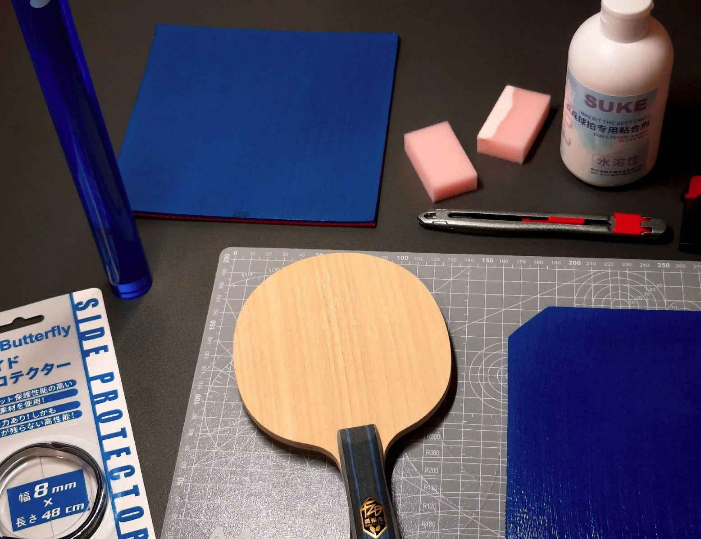
    

    

      

        <h1 class="mg-sb-hero__title">Table tennis gear, bought from China for you</h1>
        
Send a product link &middot; I quote it in USD &middot; I buy and assemble it for you

        <form class="mg-sb-search" id="home-search-form" role="search">
          <label class="mg-sb-search__field">
            <svg class="mg-sb-search__icon" viewBox="0 0 24 24" width="18" height="18" aria-hidden="true" focusable="false">
              <circle cx="11" cy="11" r="6.5" fill="none" stroke="currentColor" stroke-width="2"/>
              <path d="m16 16 5 5" fill="none" stroke="currentColor" stroke-width="2" stroke-linecap="round"/>
            </svg>
            <input type="text" id="home-search" name="q" autocomplete="off" placeholder="Paste an Amazon, AliExpress or any store link" aria-label="Paste a product link for a sourcing price, or type a word to filter the shelf">
          </label>
          <button class="mg-sb-search__submit" type="submit">Get price</button>
        </form>
        

        

          <a class="mg-sb-chip" href="#gear">Popular add-ons</a>
          <a class="mg-sb-chip" href="#how">How sourcing works</a>
          <a class="mg-sb-chip" href="https://wa.me/8618627156285?text=Hello%2C%20I%27d%20like%20a%20quote%20for%20table%20tennis%20gear.%0D%0A%0D%0AShip%20to%20(city%20%2F%20postal%20code)%3A%0D%0A%0D%0A">Chat on WhatsApp</a>
        

      

    

  </section>

  <section class="mg-sb-journey" id="how">
    

      

        <ol class="mg-sb-journey__steps">
          <li class="mg-sb-step">
            
1 Send a link

            
Paste a link to gear you want that my shop doesn't carry.

          </li>
          <li class="mg-sb-step">
            
2 I quote it in USD

            
One price for the item and its shipping — I buy it in China for you.

          </li>
          <li class="mg-sb-step">
            
3 Confirm on WhatsApp

            
Pay in the chat; I buy the piece, assemble it and ship it to your door — see <a href="/order/">How to Order</a>.

          </li>
        </ol>
        

          
          
          
        

      

    

  </section>

  <section class="mg-sb-features">
    

      

        <a class="mg-sb-feature mg-sb-feature--blades" href="/blades/">
          
            Catalogue
            Blades
          
          <svg viewBox="0 0 24 24" width="18" height="18" aria-hidden="true" focusable="false"><path d="M5 12h13M13 6l6 6-6 6" fill="none" stroke="currentColor" stroke-width="2.2" stroke-linecap="round" stroke-linejoin="round"/></svg>
        </a>
        <a class="mg-sb-feature mg-sb-feature--rubbers" href="/rubbers/">
          
            Catalogue
            Rubbers
          
          <svg viewBox="0 0 24 24" width="18" height="18" aria-hidden="true" focusable="false"><path d="M5 12h13M13 6l6 6-6 6" fill="none" stroke="currentColor" stroke-width="2.2" stroke-linecap="round" stroke-linejoin="round"/></svg>
        </a>
        <a class="mg-sb-feature mg-sb-feature--preowned" href="/pre-owned/">
          
            Catalogue
            Pre-owned
          
          <svg viewBox="0 0 24 24" width="18" height="18" aria-hidden="true" focusable="false"><path d="M5 12h13M13 6l6 6-6 6" fill="none" stroke="currentColor" stroke-width="2.2" stroke-linecap="round" stroke-linejoin="round"/></svg>
        </a>
        <a class="mg-sb-feature mg-sb-feature--setups" href="/setups/">
          
            Players
            Setups
          
          <svg viewBox="0 0 24 24" width="18" height="18" aria-hidden="true" focusable="false"><path d="M5 12h13M13 6l6 6-6 6" fill="none" stroke="currentColor" stroke-width="2.2" stroke-linecap="round" stroke-linejoin="round"/></svg>
        </a>
      

    

  </section>

  <section class="mg-sb-discovery" id="gear">
    

      <header class="mg-sb-discovery__head">
        <h2 class="mg-sb-discovery__title">Popular add-ons</h2>
        <a class="mg-sb-chat" href="https://wa.me/8618627156285?text=Hello%2C%20I%27d%20like%20a%20quote%20for%20table%20tennis%20accessories.%0D%0A%0D%0AShip%20to%20(city%20%2F%20postal%20code)%3A%0D%0A%0D%0A">Open live chat</a>
      </header>

      
The extras players most often add to their orders — glue, boosters, balls, cases, shoes and care kits, each line priced and one tap from the cart.

      

        <button class="mg-sb-pill is-active" type="button" data-category="all" aria-pressed="true">All</button>
        <button class="mg-sb-pill" type="button" data-category="glue" aria-pressed="false">Glue &amp; boosters</button>
        <button class="mg-sb-pill" type="button" data-category="balls" aria-pressed="false">Balls</button>
        <button class="mg-sb-pill" type="button" data-category="cases" aria-pressed="false">Cases</button>
        <button class="mg-sb-pill" type="button" data-category="care" aria-pressed="false">Care</button>
        <button class="mg-sb-pill" type="button" data-category="shoes" aria-pressed="false">Shoes</button>
      

      

        <article class="mg-sb-card" data-category="shoes" data-search="li-ning qilin 2.0 pe fan zhendong match shoe shoes">
          

            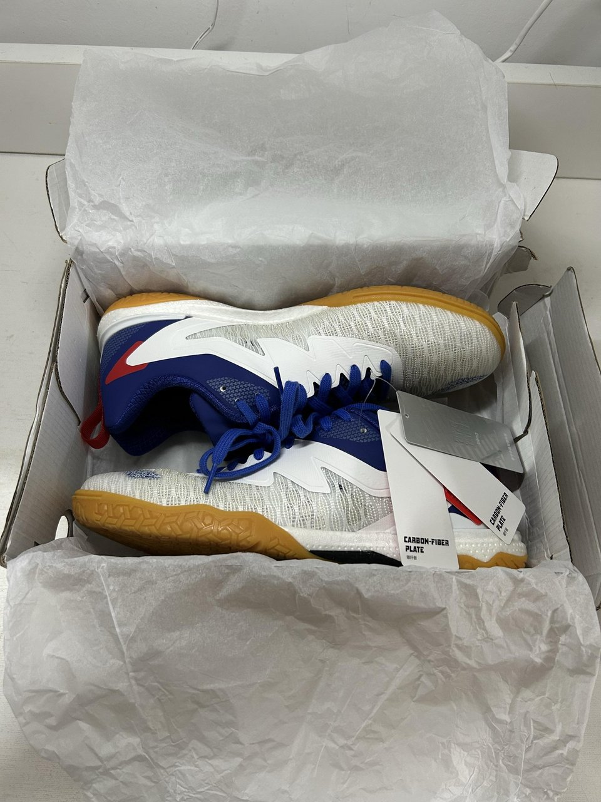
          

          <h3 class="mg-sb-card__title">Fan Zhendong's match shoe — Li-Ning Qilin 2.0 PE</h3>
          
$125

          

            <button type="button" class="mg-cart-add" aria-label="Add Li-Ning Qilin 2.0 PE to cart" data-name="Li-Ning Qilin 2.0 PE" data-price="125">Add to cart</button>
          

        </article>

        <article class="mg-sb-card" data-category="glue" data-search="dhs no.15 no15 voc-free glue water based glue">
          

            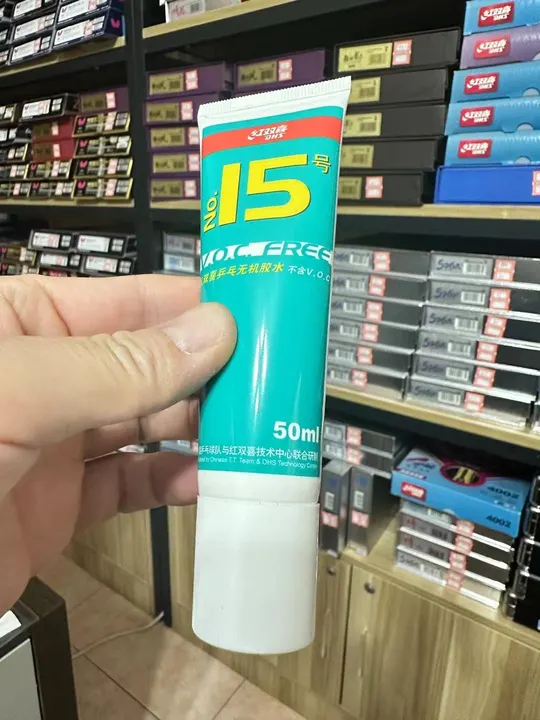
          

          <h3 class="mg-sb-card__title">DHS No.15 VOC-Free Glue</h3>
          
$8

          

            <button type="button" class="mg-cart-add" aria-label="Add DHS No.15 VOC-Free Glue to cart" data-name="DHS No.15 VOC-Free Glue" data-price="8">Add to cart</button>
          

        </article>

        <article class="mg-sb-card" data-category="care" data-search="dhs blade professional lacquer seal blade care">
          

            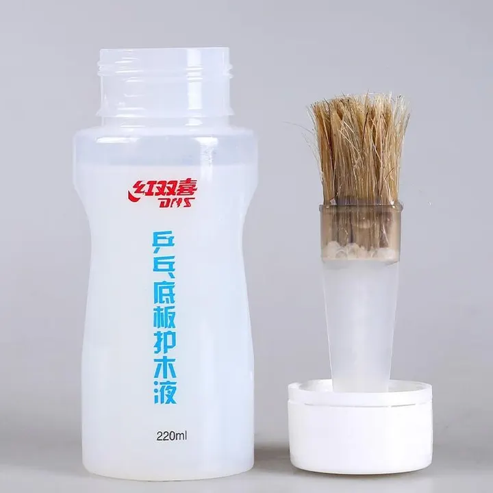
          

          <h3 class="mg-sb-card__title">DHS Blade Professional Lacquer</h3>
          
$10

          

            <button type="button" class="mg-cart-add" aria-label="Add DHS Blade Professional Lacquer to cart" data-name="DHS Blade Professional Lacquer" data-price="10">Add to cart</button>
          

        </article>

        <article class="mg-sb-card" data-category="glue" data-search="haifu national black oil booster">
          

            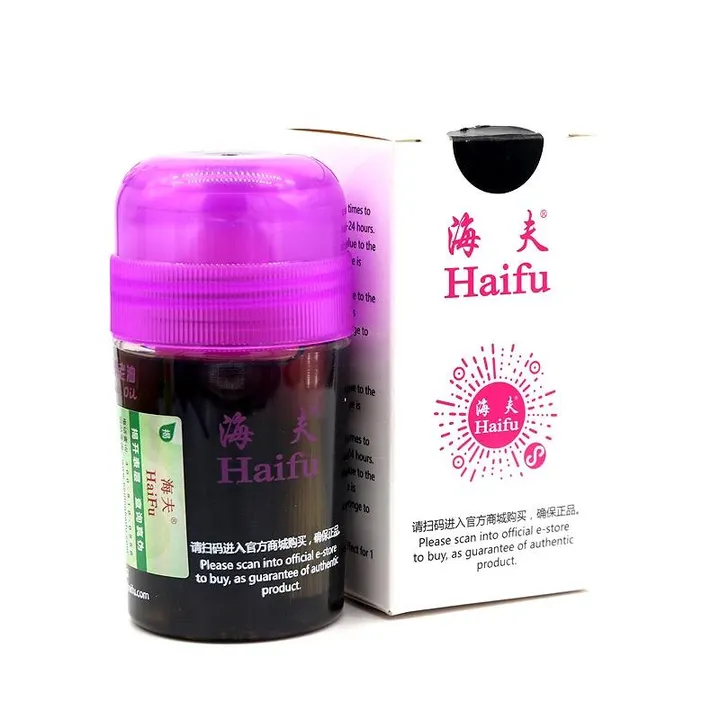
          

          <h3 class="mg-sb-card__title">Haifu National Black Oil</h3>
          
$18

          

            <button type="button" class="mg-cart-add" aria-label="Add Haifu National Black Oil to cart" data-name="Haifu National Black Oil" data-price="18">Add to cart</button>
          

        </article>

        <article class="mg-sb-card" data-category="glue" data-search="haifu sea moon booster">
          

            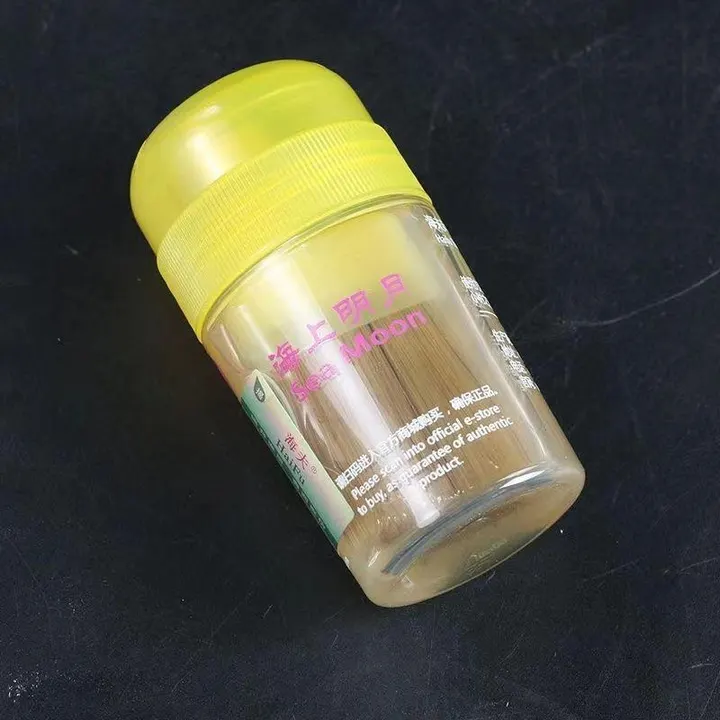
          

          <h3 class="mg-sb-card__title">Haifu Sea Moon Booster</h3>
          
$8

          

            <button type="button" class="mg-cart-add" aria-label="Add Haifu Sea Moon Booster to cart" data-name="Haifu Sea Moon Booster" data-price="8">Add to cart</button>
          

        </article>

        <article class="mg-sb-card" data-category="balls" data-search="dhs 3-star three star balls table tennis balls">
          

            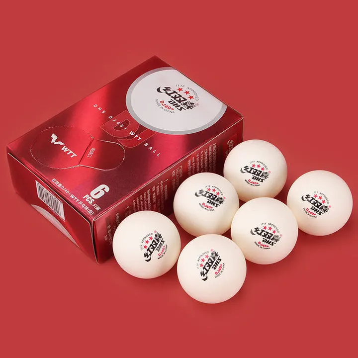
          

          <h3 class="mg-sb-card__title">DHS 3-Star Balls</h3>
          
$5

          

            <button type="button" class="mg-cart-add" aria-label="Add DHS 3-Star Balls to cart" data-name="DHS 3-Star Balls" data-price="5">Add to cart</button>
          

        </article>

        <article class="mg-sb-card" data-category="cases" data-search="hard case for racket bat case">
          

            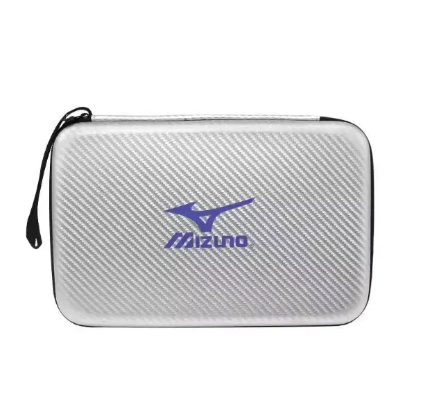
          

          <h3 class="mg-sb-card__title">Hard Case for Racket</h3>
          
$5

          

            <button type="button" class="mg-cart-add" aria-label="Add Hard Case for Racket to cart" data-name="Hard Case for Racket" data-price="5">Add to cart</button>
          

        </article>

        <article class="mg-sb-card" data-category="care" data-search="nittaku cleaning sponge cleaner care">
          

            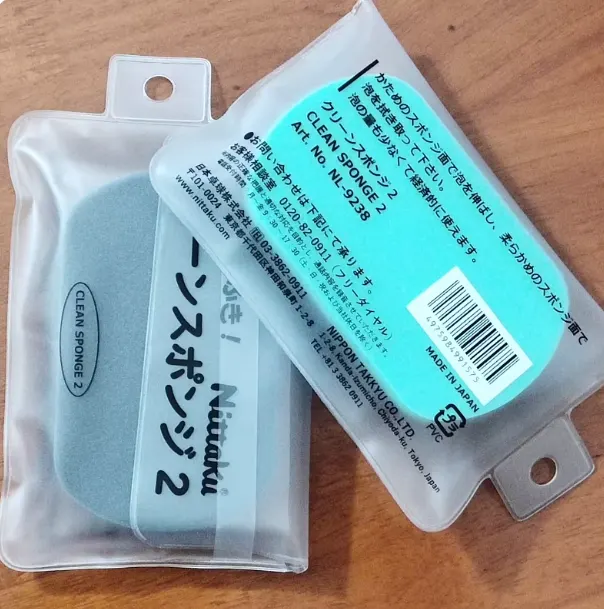
          

          <h3 class="mg-sb-card__title">Nittaku Cleaning Sponge</h3>
          
$1

          

            <button type="button" class="mg-cart-add" aria-label="Add Nittaku Cleaning Sponge to cart" data-name="Nittaku Cleaning Sponge" data-price="1">Add to cart</button>
          

        </article>

        <article class="mg-sb-card" data-category="cases" data-search="rubber protective sleeve cover racket case">
          

            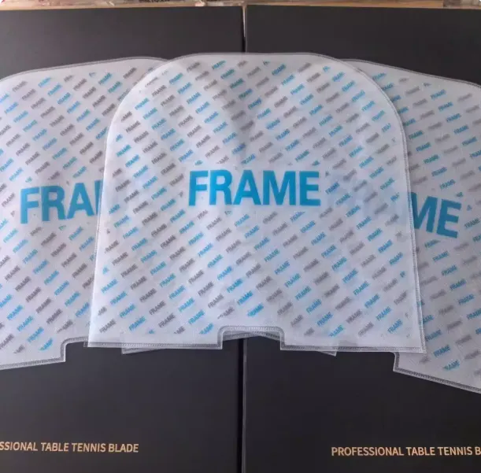
          

          <h3 class="mg-sb-card__title">Rubber Protective Sleeve</h3>
          
$1

          

            <button type="button" class="mg-cart-add" aria-label="Add Rubber Protective Sleeve to cart" data-name="Rubber Protective Sleeve" data-price="1">Add to cart</button>
          

        </article>

        <article class="mg-sb-card" data-category="care" data-search="sdi 3006c rubber cutter scissors care">
          

            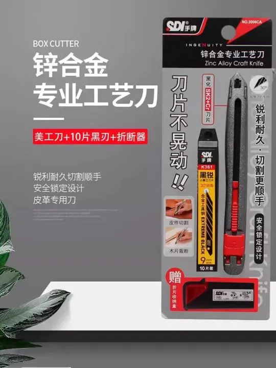
          

          <h3 class="mg-sb-card__title">SDI 3006C Rubber Cutter</h3>
          
$5

          

            <button type="button" class="mg-cart-add" aria-label="Add SDI 3006C Rubber Cutter to cart" data-name="SDI 3006C Rubber Cutter" data-price="5">Add to cart</button>
          

        </article>

        <article class="mg-sb-card" data-category="cases" data-search="butterfly 2025 racket case bat case">
          

            
          

          <h3 class="mg-sb-card__title">Butterfly 2025 Racket Case</h3>
          
$30

          

            <button type="button" class="mg-cart-add" aria-label="Add Butterfly 2025 Racket Case to cart" data-name="Butterfly 2025 Racket Case" data-price="30">Add to cart</button>
          

        </article>

        <article class="mg-sb-card" data-category="care" data-search="butterfly wristband sweatband care">
          

            
          

          <h3 class="mg-sb-card__title">Butterfly Wristband</h3>
          
$10

          

            <button type="button" class="mg-cart-add" aria-label="Add Butterfly Wristband to cart" data-name="Butterfly Wristband" data-price="10">Add to cart</button>
          

        </article>

        <article class="mg-sb-card" data-category="cases" data-search="butterfly 2026 racket bag bag case">
          

            
          

          <h3 class="mg-sb-card__title">Butterfly 2026 Racket Bag</h3>
          
$31

          

            <button type="button" class="mg-cart-add" aria-label="Add Butterfly 2026 Racket Bag to cart" data-name="Butterfly 2026 Racket Bag" data-price="31">Add to cart</button>
          

        </article>

        <article class="mg-sb-card" data-category="care" data-search="butterfly 2026 sports towel care">
          

            
          

          <h3 class="mg-sb-card__title">Butterfly 2026 Sports Towel</h3>
          
$6

          

            <button type="button" class="mg-cart-add" aria-label="Add Butterfly 2026 Sports Towel to cart" data-name="Butterfly 2026 Sports Towel" data-price="6">Add to cart</button>
          

        </article>

      

      
Nothing on the shelf matches that search — <a href="https://wa.me/8618627156285?text=Hello%2C%20I%27m%20looking%20for%20a%20table%20tennis%20accessory%20you%20don%27t%20list.">ask me in the chat</a> and I will look for it.

    

  </section>

