<!-- mg-shop--wide (2026-11-12, user: 「是的 rubbers， pre-owned 也同样进行处理」,
     following /blades/): the marker gives this page the home page's 1200px
     measure (uncrate.css), and extra.css turns the grid five-up from 1100px. -->

  <section class="mg-home-hero mg-home-hero--shop mg-hero-slides" aria-label="Table tennis rubber photos">
    

      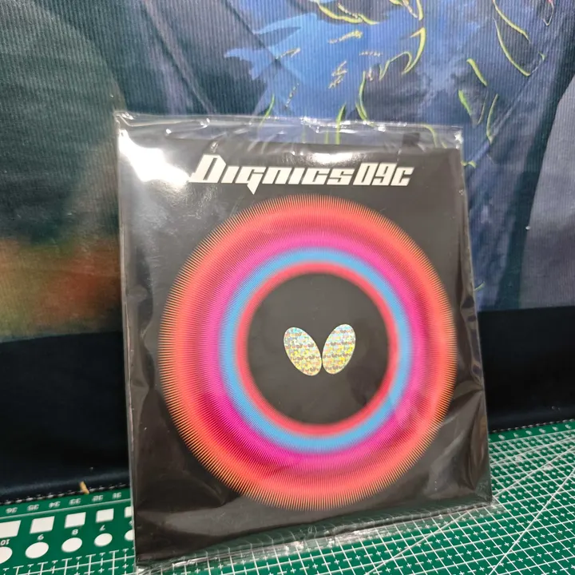
      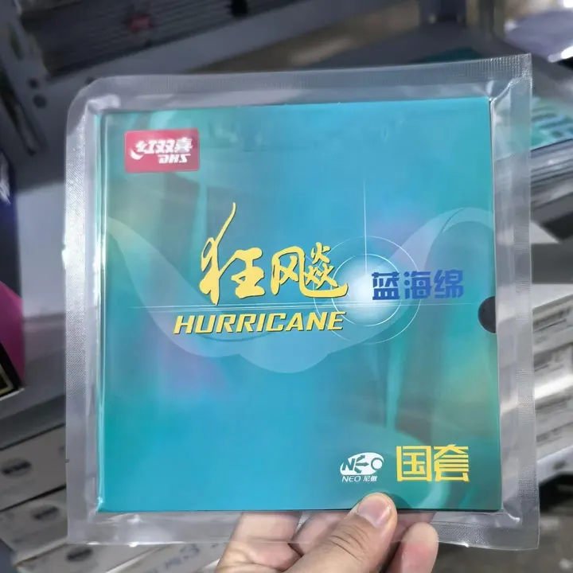
      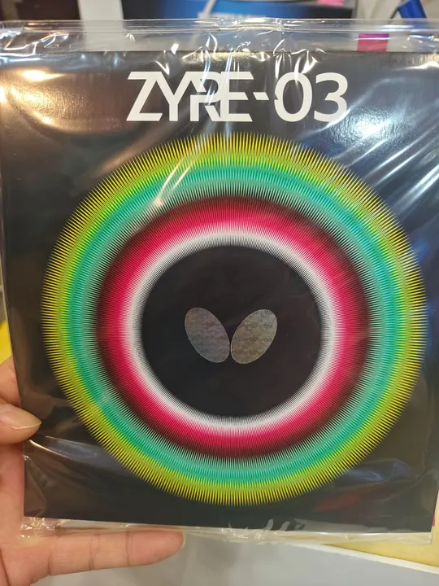
      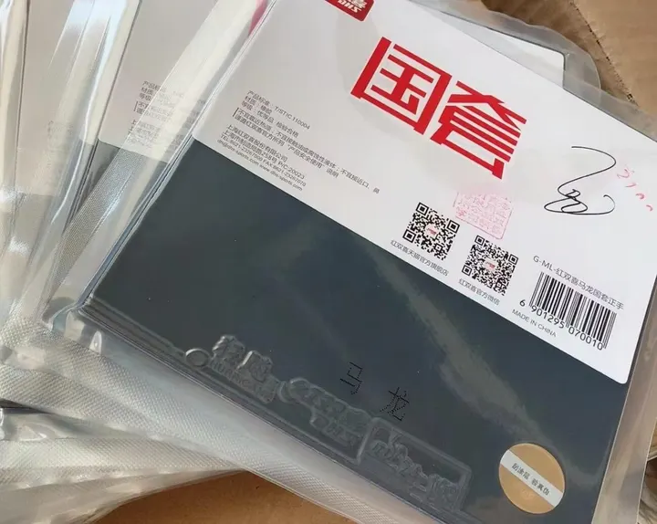
      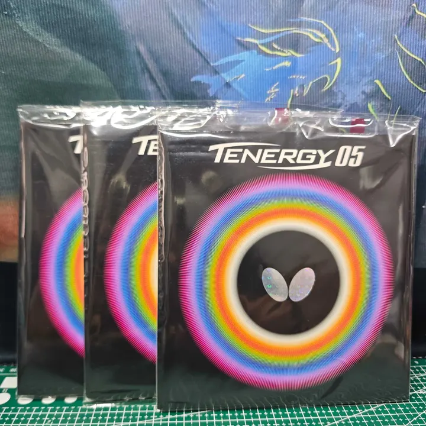
      
    

    

      
MyGear.Top

      <h1 class="mg-home-hero__title">Table Tennis Rubbers</h1>
      
Prices are in <strong>USD</strong> — tap <strong>+</strong> to build a cart, then WhatsApp checkout for your final total (items + shipping). <strong>Proxy-buy</strong> items are ordered from suppliers only after you confirm, so please allow an extra <strong>2–3 days</strong>.

      

        <a class="mg-home-hero__btn mg-home-hero__btn--primary" href="https://wa.me/8618627156285?text=Hello%2C%20I%27d%20like%20a%20quote%20for%20table%20tennis%20rubbers.%0D%0A%0D%0AShip%20to%20(city%20%2F%20postal%20code)%3A%0D%0A%0D%0A">Get rubber pricing</a>
        <a class="mg-home-hero__btn mg-home-hero__btn--ghost" href="/order/">How to Order</a>
      

    

  </section>

<!-- One list, two ways of getting the rubber. The first thirteen are in our own
     inventory; the rest are ordered from suppliers after you confirm, which is
     the 2-3 day wait the hero warns about. The difference is said with the
     corner badge on each card rather than with a heading over half the grid, so
     the two kinds sit in one continuous list. -->

<!-- Brand pills, in the shape acebase.cc's shelf uses (2026-11-12, user:
     「将 http://127.0.0.1:8001/rubbers/ 的商品样式和分类模仿 https://acebase.cc/
     的 Latest prices on hot gear 的货架效果」). That shelf moved from brand
     pills to category pills when its twenty-odd brands would not fit a line;
     twelve brands do fit here, and for a rubber a brand is the thing a buyer
     narrows by. Each card carries the matching data-category and the pills
     carry the same value, which is all shop-pills.js reads — the counts at the
     time of writing: DHS 8, Butterfly 7, Tibhar 6, Stiga 5, Donic 4, Victas 4,
     Xiom 3, Joola 2, and Gewo / Yasaka / Nittaku / Friendship one each. -->

  <button type="button" class="mg-shop-pill is-active" data-category="all" aria-pressed="true">All</button>
  <button type="button" class="mg-shop-pill" data-category="dhs" aria-pressed="false">DHS</button>
  <button type="button" class="mg-shop-pill" data-category="butterfly" aria-pressed="false">Butterfly</button>
  <button type="button" class="mg-shop-pill" data-category="tibhar" aria-pressed="false">Tibhar</button>
  <button type="button" class="mg-shop-pill" data-category="stiga" aria-pressed="false">Stiga</button>
  <button type="button" class="mg-shop-pill" data-category="donic" aria-pressed="false">Donic</button>
  <button type="button" class="mg-shop-pill" data-category="victas" aria-pressed="false">Victas</button>
  <button type="button" class="mg-shop-pill" data-category="xiom" aria-pressed="false">Xiom</button>
  <button type="button" class="mg-shop-pill" data-category="joola" aria-pressed="false">Joola</button>
  <button type="button" class="mg-shop-pill" data-category="gewo" aria-pressed="false">Gewo</button>
  <button type="button" class="mg-shop-pill" data-category="yasaka" aria-pressed="false">Yasaka</button>
  <button type="button" class="mg-shop-pill" data-category="nittaku" aria-pressed="false">Nittaku</button>
  <button type="button" class="mg-shop-pill" data-category="friendship" aria-pressed="false">Friendship</button>

<!-- The cards are drawn as the shelf's are (2026-11-12, same request): a white
     rounded card holding a square photo, a two-line name, the price on its own
     line under it, the thickness / colour picker, and an action row whose disc
     sits at the right edge. The picker is not in the markup — price-cart.js
     reads the picture's data-options and builds it, keeping the cart line's
     name in step with the choice. The photo itself opens the lightbox. The
     skin is scoped to .mg-preowned-grid--shelf in extra.css, which /blades/
     wears too since the same day's follow-up (「将 http://127.0.0.1:8001/
     blades/ 页也同样处理」); /pre-owned/ and /add-ons/ keep the recipe they
     had. -->

  <article class="mg-preowned-card" role="listitem" data-category="butterfly">
    

      In stock
      
    

    <!-- The only card on this page that also has an article behind it: the
         ZYRE-03 review at /gear/zyre-03/, reached through the name. Nothing
         extra is added to the card, so it keeps the shape of every other one
         (2026-11-13). -->
    <h3 class="mg-preowned-card__title"><a href="/gear/zyre-03/">Butterfly ZYRE-03</a></h3>
    
$89

    <button type="button" class="mg-cart-add mg-preowned-card__cart" aria-label="Add Butterfly ZYRE-03 to cart" data-name="Butterfly ZYRE-03" data-price="89">+Add to cart</button>
  </article>

  <article class="mg-preowned-card" role="listitem" data-category="butterfly">
    

      In stock
      <!-- Two photographs of our own stock (2026-11-12): the wrapped package
           front and the back with its RED 红 label. The angled second front
           shot was dropped on request. The hero slide above still uses the
           older single shot. -->
      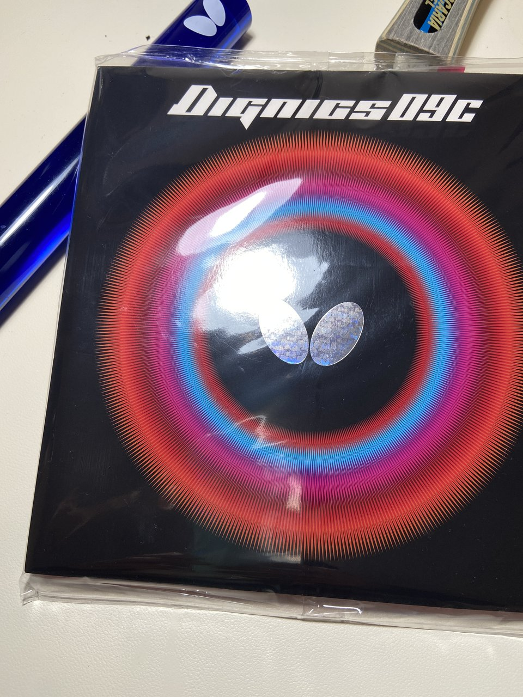
    

    <h3 class="mg-preowned-card__title">Butterfly Dignics 09C</h3>
    
$73

    <button type="button" class="mg-cart-add mg-preowned-card__cart" aria-label="Add Butterfly Dignics 09C to cart" data-name="Butterfly Dignics 09C" data-price="73">+Add to cart</button>
  </article>

  <article class="mg-preowned-card" role="listitem" data-category="butterfly">
    

      In stock
      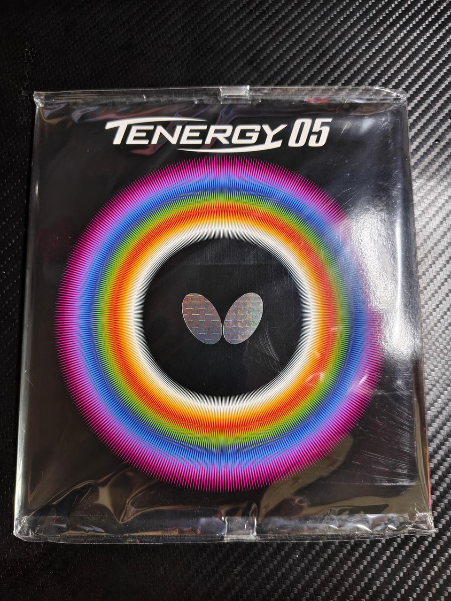
    

    <h3 class="mg-preowned-card__title">Butterfly Tenergy 05</h3>
    
$68

    <button type="button" class="mg-cart-add mg-preowned-card__cart" aria-label="Add Butterfly Tenergy 05 to cart" data-name="Butterfly Tenergy 05" data-price="68">+Add to cart</button>
  </article>

  <article class="mg-preowned-card" role="listitem" data-category="butterfly">
    

      In stock
      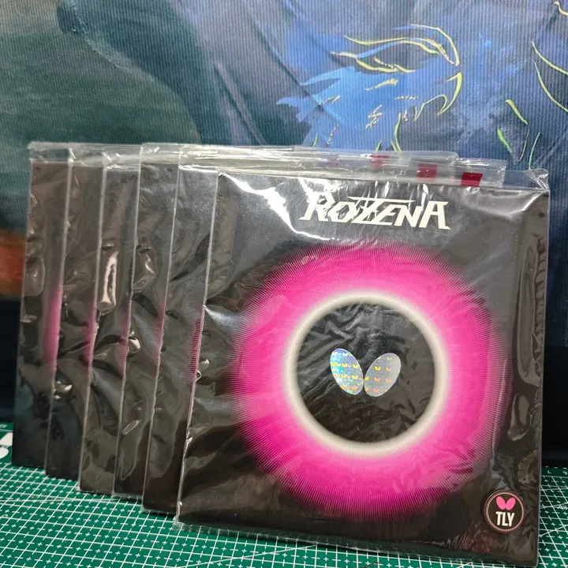
    

    <h3 class="mg-preowned-card__title">Butterfly ROZENA</h3>
    
$35

    <button type="button" class="mg-cart-add mg-preowned-card__cart" aria-label="Add Butterfly ROZENA to cart" data-name="Butterfly ROZENA" data-price="35">+Add to cart</button>
  </article>

  <article class="mg-preowned-card" role="listitem" data-category="butterfly">
    

      In stock
      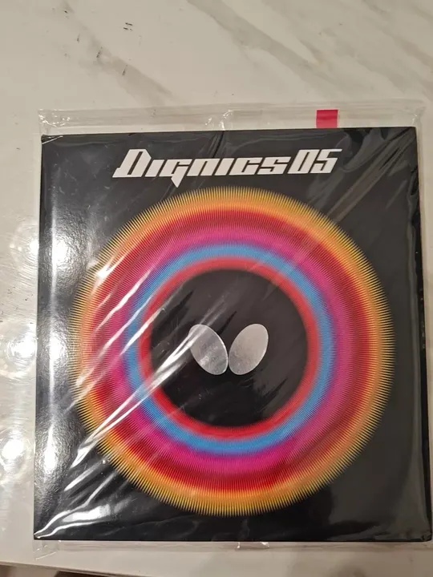
    

    <h3 class="mg-preowned-card__title">Butterfly Dignics 05</h3>
    
$68

    <button type="button" class="mg-cart-add mg-preowned-card__cart" aria-label="Add Butterfly Dignics 05 to cart" data-name="Butterfly Dignics 05" data-price="68">+Add to cart</button>
  </article>

  <article class="mg-preowned-card" role="listitem" data-category="butterfly">
    

      In stock
      
    

    <h3 class="mg-preowned-card__title">GLAYZER 09C</h3>
    
$47

    <button type="button" class="mg-cart-add mg-preowned-card__cart" aria-label="Add GLAYZER 09C to cart" data-name="GLAYZER 09C" data-price="47">+Add to cart</button>
  </article>

  <article class="mg-preowned-card" role="listitem" data-category="dhs">
    

      In stock
      <!-- Two photographs of our own stock (2026-11-12): the teal 国套
           蓝海绵 package and the printed back. The sponge shot and the DHS
           authentication side were dropped on request. The hero slide above
           still uses the older single shot. -->
      
    

    <h3 class="mg-preowned-card__title">Neo H3 National Blue</h3>
    
$50

    <button type="button" class="mg-cart-add mg-preowned-card__cart" aria-label="Add Neo H3 National Blue to cart" data-name="Neo H3 National Blue" data-price="50">+Add to cart</button>
  </article>

  <article class="mg-preowned-card" role="listitem" data-category="dhs">
    

      In stock
      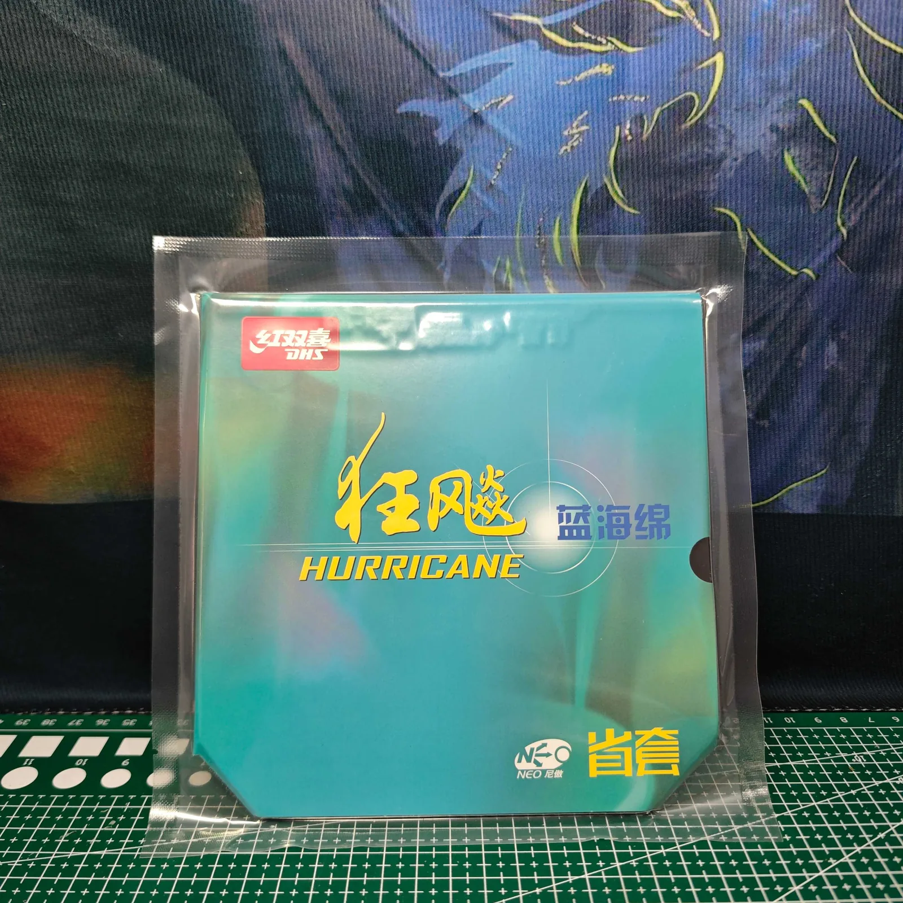
    

    <h3 class="mg-preowned-card__title">NEO Hurricane 3 Provincial Blue</h3>
    
$33

    <button type="button" class="mg-cart-add mg-preowned-card__cart" aria-label="Add NEO Hurricane 3 Provincial Blue to cart" data-name="NEO Hurricane 3 Provincial Blue" data-price="33">+Add to cart</button>
  </article>

  <article class="mg-preowned-card" role="listitem" data-category="stiga">
    

      In stock
      
    

    <h3 class="mg-preowned-card__title">Stiga Mantra M</h3>
    
$30

    <button type="button" class="mg-cart-add mg-preowned-card__cart" aria-label="Add Stiga Mantra M to cart" data-name="Stiga Mantra M" data-price="30">+Add to cart</button>
  </article>

  <article class="mg-preowned-card" role="listitem" data-category="dhs">
    

      In stock
      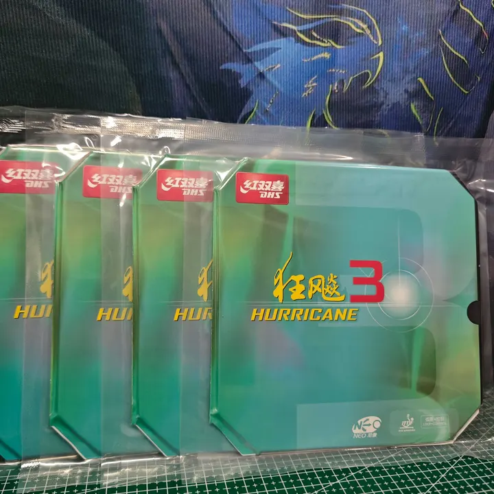
    

    <h3 class="mg-preowned-card__title">Neo Hurricane 3</h3>
    
$21

    <button type="button" class="mg-cart-add mg-preowned-card__cart" aria-label="Add Neo Hurricane 3 to cart" data-name="Neo Hurricane 3" data-price="21">+Add to cart</button>
  </article>

  <article class="mg-preowned-card" role="listitem" data-category="dhs">
    

      In stock
      
    

    <h3 class="mg-preowned-card__title">Neo Hurricane 3 Provincial Orange</h3>
    
$28

    <button type="button" class="mg-cart-add mg-preowned-card__cart" aria-label="Add Neo Hurricane 3 Provincial Orange to cart" data-name="Neo Hurricane 3 Provincial Orange" data-price="28">+Add to cart</button>
  </article>

  <article class="mg-preowned-card" role="listitem" data-category="donic">
    

      In stock
      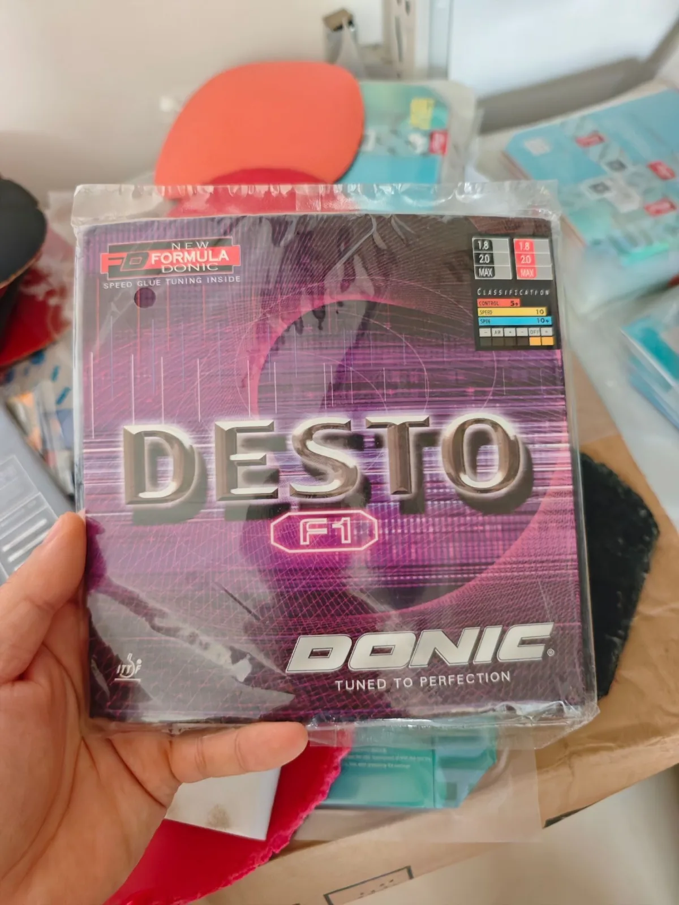
    

    <h3 class="mg-preowned-card__title">DONIC Desto F1</h3>
    
$27

    <button type="button" class="mg-cart-add mg-preowned-card__cart" aria-label="Add DONIC Desto F1 to cart" data-name="DONIC Desto F1" data-price="27">+Add to cart</button>
  </article>

  <article class="mg-preowned-card" role="listitem" data-category="stiga">
    

      Proxy buy
      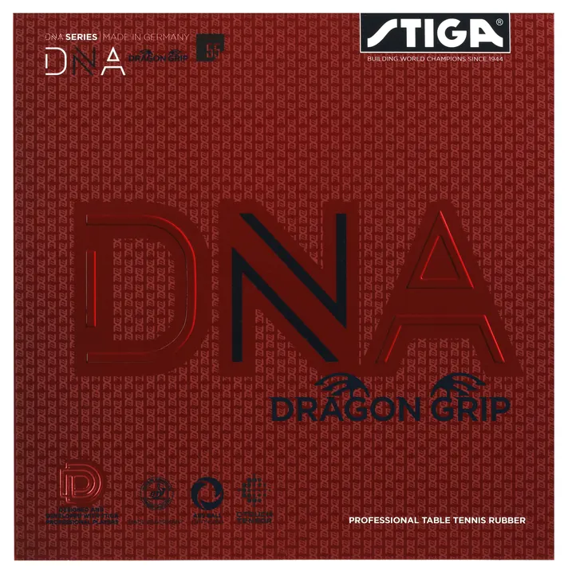
    

    <h3 class="mg-preowned-card__title">Stiga DNA Dragon Grip 55</h3>
    
$28

    <button type="button" class="mg-cart-add mg-preowned-card__cart" aria-label="Add Stiga DNA Dragon Grip 55 to cart" data-name="Stiga DNA Dragon Grip 55" data-price="28">+Add to cart</button>
  </article>

  <article class="mg-preowned-card" role="listitem" data-category="stiga">
    

      Proxy buy
      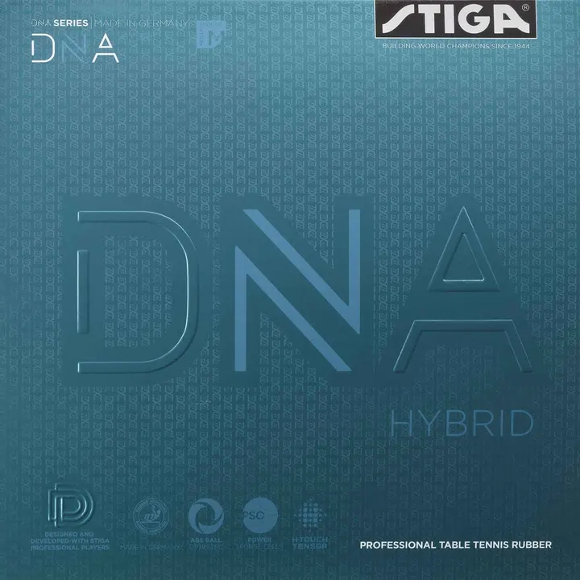
    

    <h3 class="mg-preowned-card__title">Stiga DNA Hybrid M</h3>
    
$38

    <button type="button" class="mg-cart-add mg-preowned-card__cart" aria-label="Add Stiga DNA Hybrid M to cart" data-name="Stiga DNA Hybrid M" data-price="38">+Add to cart</button>
  </article>

  <article class="mg-preowned-card" role="listitem" data-category="stiga">
    

      Proxy buy
      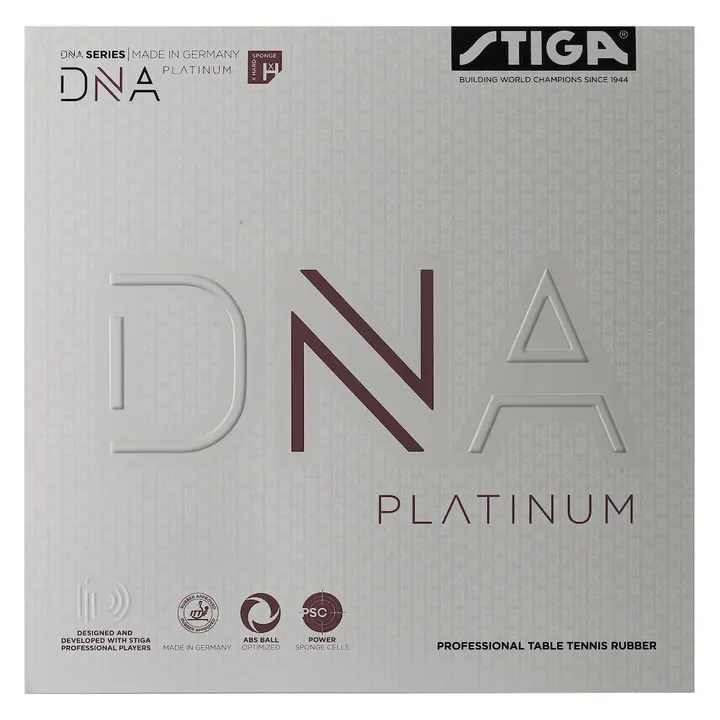
    

    <h3 class="mg-preowned-card__title">Stiga DNA Platinum XH</h3>
    
$38

    <button type="button" class="mg-cart-add mg-preowned-card__cart" aria-label="Add Stiga DNA Platinum XH to cart" data-name="Stiga DNA Platinum XH" data-price="38">+Add to cart</button>
  </article>

  <article class="mg-preowned-card" role="listitem" data-category="gewo">
    

      Proxy buy
      
    

    <h3 class="mg-preowned-card__title">Gewo Proton Neo 450</h3>
    
$29

    <button type="button" class="mg-cart-add mg-preowned-card__cart" aria-label="Add Gewo Proton Neo 450 to cart" data-name="Gewo Proton Neo 450" data-price="29">+Add to cart</button>
  </article>

  <article class="mg-preowned-card" role="listitem" data-category="tibhar">
    

      Proxy buy
      
    

    <h3 class="mg-preowned-card__title">Tibhar Hybrid K1 Plus</h3>
    
$27

    <button type="button" class="mg-cart-add mg-preowned-card__cart" aria-label="Add Tibhar Hybrid K1 Plus to cart" data-name="Tibhar Hybrid K1 Plus" data-price="27">+Add to cart</button>
  </article>

  <article class="mg-preowned-card" role="listitem" data-category="tibhar">
    

      Proxy buy
      
    

    <h3 class="mg-preowned-card__title">Tibhar Hybrid K2 Pro</h3>
    
$27

    <button type="button" class="mg-cart-add mg-preowned-card__cart" aria-label="Add Tibhar Hybrid K2 Pro to cart" data-name="Tibhar Hybrid K2 Pro" data-price="27">+Add to cart</button>
  </article>

  <article class="mg-preowned-card" role="listitem" data-category="victas">
    

      Proxy buy
      
    

    <h3 class="mg-preowned-card__title">Victas V&gt;102</h3>
    
$34

    <button type="button" class="mg-cart-add mg-preowned-card__cart" aria-label="Add Victas V&gt;102 to cart" data-name="Victas V&gt;102" data-price="34">+Add to cart</button>
  </article>

  <article class="mg-preowned-card" role="listitem" data-category="victas">
    

      Proxy buy
      
    

    <h3 class="mg-preowned-card__title">Victas Spectol S3</h3>
    
$34

    <button type="button" class="mg-cart-add mg-preowned-card__cart" aria-label="Add Victas Spectol S3 to cart" data-name="Victas Spectol S3" data-price="34">+Add to cart</button>
  </article>

  <article class="mg-preowned-card" role="listitem" data-category="victas">
    

      Proxy buy
      
    

    <h3 class="mg-preowned-card__title">Victas V&gt;15 Stiff</h3>
    
$38

    <button type="button" class="mg-cart-add mg-preowned-card__cart" aria-label="Add Victas V&gt;15 Stiff to cart" data-name="Victas V&gt;15 Stiff" data-price="38">+Add to cart</button>
  </article>

  <article class="mg-preowned-card" role="listitem" data-category="butterfly">
    

      Proxy buy
      
    

    <h3 class="mg-preowned-card__title">FLEXTRA</h3>
    
$25

    <button type="button" class="mg-cart-add mg-preowned-card__cart" aria-label="Add FLEXTRA to cart" data-name="FLEXTRA" data-price="25">+Add to cart</button>
  </article>

  <article class="mg-preowned-card" role="listitem" data-category="dhs">
    

      Proxy buy
      
    

    <h3 class="mg-preowned-card__title">Hurricane 3 Star National</h3>
    
$71

    <button type="button" class="mg-cart-add mg-preowned-card__cart" aria-label="Add Hurricane 3 Star National to cart" data-name="Hurricane 3 Star National" data-price="71">+Add to cart</button>
  </article>

  <article class="mg-preowned-card" role="listitem" data-category="dhs">
    

      Proxy buy
      
    

    <h3 class="mg-preowned-card__title">Hurricane 3 National Blue Sponge</h3>
    
$45

    <button type="button" class="mg-cart-add mg-preowned-card__cart" aria-label="Add Hurricane 3 National Blue Sponge to cart" data-name="Hurricane 3 National Blue Sponge" data-price="45">+Add to cart</button>
  </article>

  <article class="mg-preowned-card" role="listitem" data-category="tibhar">
    

      Proxy buy
      
    

    <h3 class="mg-preowned-card__title">Tibhar Evolution MX-P</h3>
    
$39

    <button type="button" class="mg-cart-add mg-preowned-card__cart" aria-label="Add Tibhar Evolution MX-P to cart" data-name="Tibhar Evolution MX-P" data-price="39">+Add to cart</button>
  </article>

  <article class="mg-preowned-card" role="listitem" data-category="tibhar">
    

      Proxy buy
      <!-- Two photographs of our own stock (2026-11-12): the MAX black
           package front and the back with the hardness table. -->
      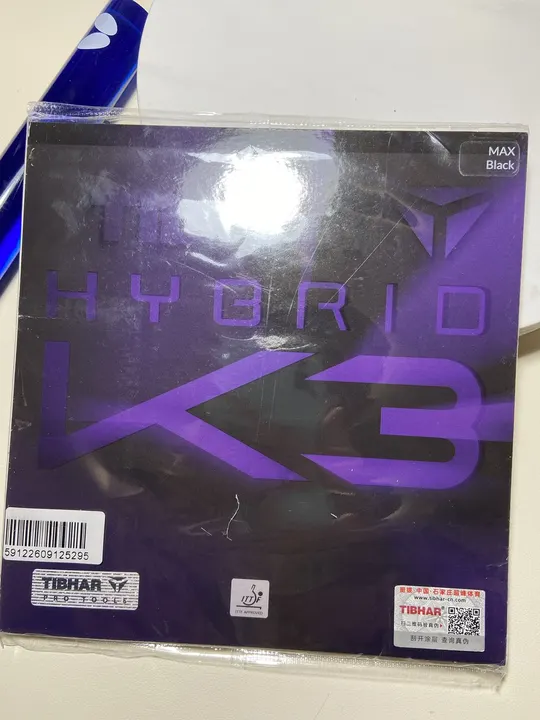
    

    <h3 class="mg-preowned-card__title">Tibhar Hybrid K3</h3>
    
$49

    <button type="button" class="mg-cart-add mg-preowned-card__cart" aria-label="Add Tibhar Hybrid K3 to cart" data-name="Tibhar Hybrid K3" data-price="49">+Add to cart</button>
  </article>

  <article class="mg-preowned-card" role="listitem" data-category="xiom">
    

      Proxy buy
      
    

    <h3 class="mg-preowned-card__title">Xiom Vega Asia</h3>
    
$29

    <button type="button" class="mg-cart-add mg-preowned-card__cart" aria-label="Add Xiom Vega Asia to cart" data-name="Xiom Vega Asia" data-price="29">+Add to cart</button>
  </article>

  <article class="mg-preowned-card" role="listitem" data-category="xiom">
    

      Proxy buy
      
    

    <h3 class="mg-preowned-card__title">XIOM Vega China</h3>
    
$30

    <button type="button" class="mg-cart-add mg-preowned-card__cart" aria-label="Add XIOM Vega China to cart" data-name="XIOM Vega China" data-price="30">+Add to cart</button>
  </article>

  <article class="mg-preowned-card" role="listitem" data-category="yasaka">
    

      Proxy buy
      
    

    <h3 class="mg-preowned-card__title">Yasaka Rakza 7 Soft</h3>
    
$39

    <button type="button" class="mg-cart-add mg-preowned-card__cart" aria-label="Add Yasaka Rakza 7 Soft to cart" data-name="Yasaka Rakza 7 Soft" data-price="39">+Add to cart</button>
  </article>

  <article class="mg-preowned-card" role="listitem" data-category="victas">
    

      Proxy buy
      
    

    <h3 class="mg-preowned-card__title">Victas V &gt; 15 Extra</h3>
    
$36

    <button type="button" class="mg-cart-add mg-preowned-card__cart" aria-label="Add Victas V &gt; 15 Extra to cart" data-name="Victas V &gt; 15 Extra" data-price="36">+Add to cart</button>
  </article>

  <article class="mg-preowned-card" role="listitem" data-category="donic">
    

      Proxy buy
      
    

    <h3 class="mg-preowned-card__title">Donic BlueGrip J1</h3>
    
$46

    <button type="button" class="mg-cart-add mg-preowned-card__cart" aria-label="Add Donic BlueGrip J1 to cart" data-name="Donic BlueGrip J1" data-price="46">+Add to cart</button>
  </article>

  <article class="mg-preowned-card" role="listitem" data-category="donic">
    

      Proxy buy
      
    

    <h3 class="mg-preowned-card__title">Donic BlueGrip J2</h3>
    
$46

    <button type="button" class="mg-cart-add mg-preowned-card__cart" aria-label="Add Donic BlueGrip J2 to cart" data-name="Donic BlueGrip J2" data-price="46">+Add to cart</button>
  </article>

  <article class="mg-preowned-card" role="listitem" data-category="nittaku">
    

      Proxy buy
      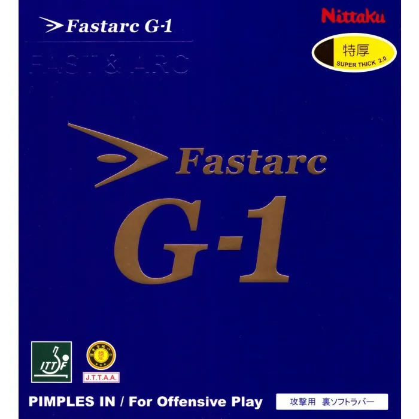
    

    <h3 class="mg-preowned-card__title">Nittaku Fastarc G-1</h3>
    
$33

    <button type="button" class="mg-cart-add mg-preowned-card__cart" aria-label="Add Nittaku Fastarc G-1 to cart" data-name="Nittaku Fastarc G-1" data-price="33">+Add to cart</button>
  </article>

  <article class="mg-preowned-card" role="listitem" data-category="tibhar">
    

      Proxy buy
      
    

    <h3 class="mg-preowned-card__title">Tibhar Evolution EL-P</h3>
    
$36

    <button type="button" class="mg-cart-add mg-preowned-card__cart" aria-label="Add Tibhar Evolution EL-P to cart" data-name="Tibhar Evolution EL-P" data-price="36">+Add to cart</button>
  </article>

  <article class="mg-preowned-card" role="listitem" data-category="donic">
    

      Proxy buy
      
    

    <h3 class="mg-preowned-card__title">Donic BlueStar A1</h3>
    
$57

    <button type="button" class="mg-cart-add mg-preowned-card__cart" aria-label="Add Donic BlueStar A1 to cart" data-name="Donic BlueStar A1" data-price="57">+Add to cart</button>
  </article>

  <article class="mg-preowned-card" role="listitem" data-category="joola">
    

      Proxy buy
      
    

    <h3 class="mg-preowned-card__title">Joola Trinity Hugo Calderano Charged</h3>
    
$62

    <button type="button" class="mg-cart-add mg-preowned-card__cart" aria-label="Add Joola Trinity Hugo Calderano Charged to cart" data-name="Joola Trinity Hugo Calderano Charged" data-price="62">+Add to cart</button>
  </article>

  <article class="mg-preowned-card" role="listitem" data-category="xiom">
    

      Proxy buy
      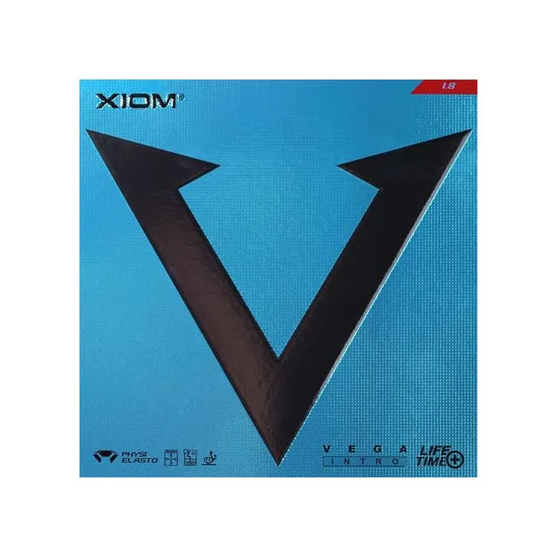
    

    <h3 class="mg-preowned-card__title">Xiom Vega Intro</h3>
    
$29

    <button type="button" class="mg-cart-add mg-preowned-card__cart" aria-label="Add Xiom Vega Intro to cart" data-name="Xiom Vega Intro" data-price="29">+Add to cart</button>
  </article>

  <article class="mg-preowned-card" role="listitem" data-category="joola">
    

      Proxy buy
      
    

    <h3 class="mg-preowned-card__title">Joola Trinity Hugo Calderano Dynamic</h3>
    
$62

    <button type="button" class="mg-cart-add mg-preowned-card__cart" aria-label="Add Joola Trinity Hugo Calderano Dynamic to cart" data-name="Joola Trinity Hugo Calderano Dynamic" data-price="62">+Add to cart</button>
  </article>

  <!-- Added 2026-11-12 from a supplier listing, at its €17.21 converted
       to $19 (x1.111287 on the day, rounded). Eight variants: 1.5 / 1.8 /
       2.0 / 2.2 mm, each in red and black. Short pips, ITTF approved. -->
  <article class="mg-preowned-card" role="listitem" data-category="friendship">
    

      Proxy buy
      
    

    <h3 class="mg-preowned-card__title">Friendship RITC 802-40</h3>
    
$19

    <button type="button" class="mg-cart-add mg-preowned-card__cart" aria-label="Add Friendship RITC 802-40 to cart" data-name="Friendship RITC 802-40" data-price="19">+Add to cart</button>
  </article>

  <!-- Added 2026-11-12 from a supplier listing, priced by the user at $65
       (「价格设置为$65」; the listing itself showed €65.49). Two variants:
       2.2 mm in red and black. XH is STIGA's extra-hard sponge grade. -->
  <article class="mg-preowned-card" role="listitem" data-category="stiga">
    

      Proxy buy
      
    

    <h3 class="mg-preowned-card__title">Stiga Helix Platinum XH</h3>
    
$65

    <button type="button" class="mg-cart-add mg-preowned-card__cart" aria-label="Add Stiga Helix Platinum XH to cart" data-name="Stiga Helix Platinum XH" data-price="65">+Add to cart</button>
  </article>

  <!-- Added 2026-11-12 from two supplier listings the user asked to merge:
       they are the same rubber at two sponge hardnesses, 38° and 37°, each
       €46.69 in 2.1 mm red or black. Priced at the user's $46. Provincial
       grade — a better-selected build of the tacky 8-80 topsheet, the
       commercial version is already on this grid at $25. -->
  <article class="mg-preowned-card" role="listitem" data-category="dhs">
    

      Proxy buy
      
    

    <h3 class="mg-preowned-card__title">DHS Hurricane Provincial 8-80</h3>
    
$42

    <button type="button" class="mg-cart-add mg-preowned-card__cart" aria-label="Add DHS Hurricane Provincial 8-80 to cart" data-name="DHS Hurricane Provincial 8-80" data-price="42">+Add to cart</button>
  </article>

  <!-- Added 2026-11-12 from five supplier listings the user asked to merge
       into one card: Hurricane 8 hard (41-43°), mid-hard, soft and 8-80 in
       37° and 38°, all €31.89, priced at the user's $28. Replaces the older
       $25 Hurricane8-80 card, which was the same rubber. The two photos are
       the only ones the listings carry: the purple 8 pack and the blue 8-80
       pack, each shared byte-for-byte by its listings. -->
  <article class="mg-preowned-card" role="listitem" data-category="dhs">
    

      Proxy buy
      
    

    <h3 class="mg-preowned-card__title">DHS Hurricane 8</h3>
    
$26

    <button type="button" class="mg-cart-add mg-preowned-card__cart" aria-label="Add DHS Hurricane 8 to cart" data-name="DHS Hurricane 8" data-price="26">+Add to cart</button>
  </article>

  <!-- Added 2026-11-12 from a supplier listing, at its €53.20 converted
       to $59 (x1.111287 on the day, rounded). The Pro's 55° sponge against
       the plain K3's 53° is what separates the two cards. Four variants:
       2.0 mm and Max, each in black and red. -->
  <article class="mg-preowned-card" role="listitem" data-category="tibhar">
    

      Proxy buy
      
    

    <h3 class="mg-preowned-card__title">Tibhar Hybrid K3 Pro</h3>
    
$59

    <button type="button" class="mg-cart-add mg-preowned-card__cart" aria-label="Add Tibhar Hybrid K3 Pro to cart" data-name="Tibhar Hybrid K3 Pro" data-price="59">+Add to cart</button>
  </article>
  <!-- Added 2026-11-13 from a supplier listing, at its €24.61 converted to
       $27 (x1.111287 on the day, 27.35 rounded). Long pips for defenders;
       the same price in every thickness. Two photographs of our own stock:
       the silver package front and the printed back with the hardness table.
       Eight variants: 1.5 / 1.0 / 0.5 mm and the sponge-free Ox, each in
       black and red. -->
  <article class="mg-preowned-card" role="listitem" data-category="victas">
    

      Proxy buy
      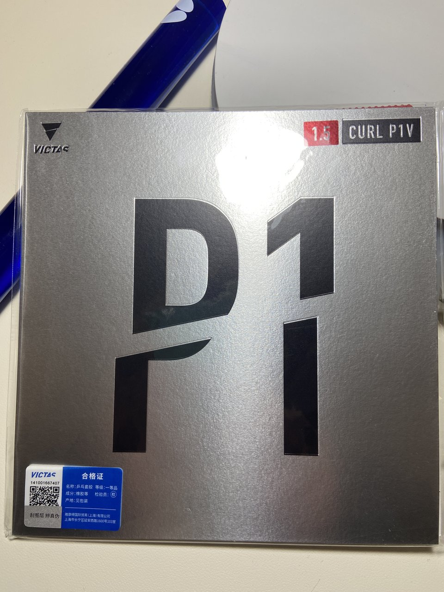
    

    <h3 class="mg-preowned-card__title">Victas Curl P1V</h3>
    
$27

    <button type="button" class="mg-cart-add mg-preowned-card__cart" aria-label="Add Victas Curl P1V to cart" data-name="Victas Curl P1V" data-price="27">+Add to cart</button>
  </article>

  
Custom

  
If you have special needs, or would like to know the proxy-buy price for another product not listed here, please <a href="https://wa.me/8618627156285?text=Hi%2C%20I%27d%20like%20a%20quote%20for%20a%20product%20not%20listed%20on%20your%20site." target="_blank" rel="noopener noreferrer">confirm with me on WhatsApp</a>.

  
Related

  
<a href="/blades/">Blades</a> · <a href="/">Home</a> · <a href="/order/">How to Order</a> · <a href="/FAQ/">FAQ & Shipping</a> · <a href="/updates/">Updates & Reviews</a>

