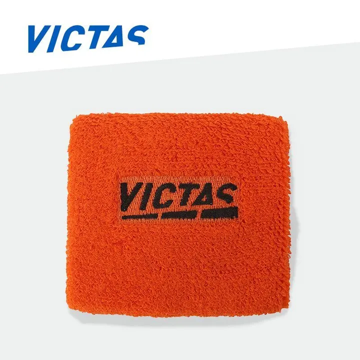
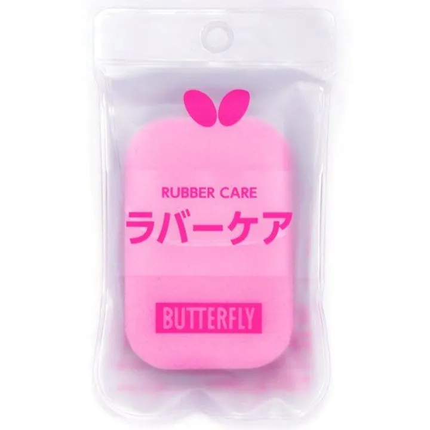
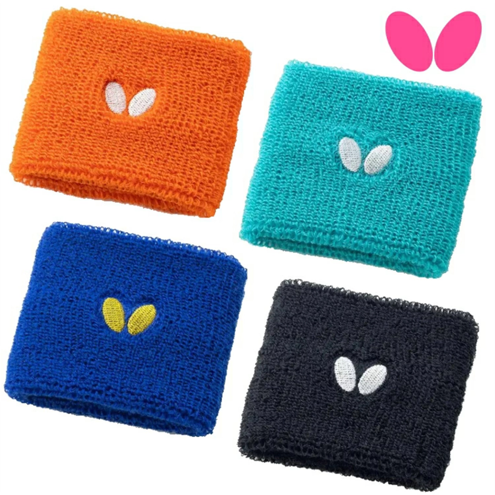
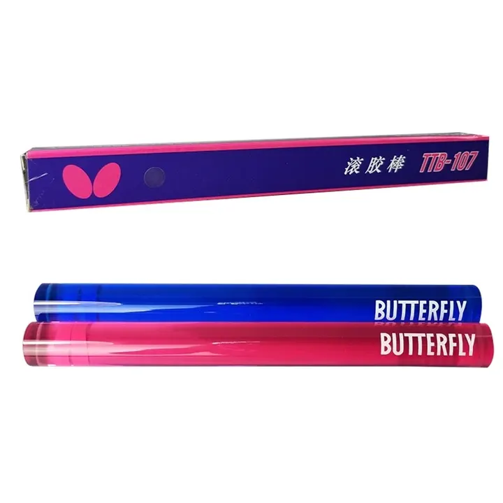
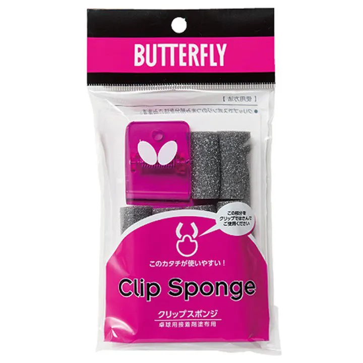

# 🏓 MyGear VIP Rewards (Beta)

Welcome to the **MyGear.Top** Member Club! Every order earns you points, which
can be redeemed for gear, vouchers, and gifts.

---

## 🔍 Quick Points Balance Lookup

  <form class="mg-vip__form" id="vip-form" novalidate>
    <label class="mg-vip__label" for="vip-phone">Enter the member phone number you used when ordering</label>
    

      <input class="mg-vip__input" type="tel" id="vip-phone" name="phone" placeholder="+1 202 555 0143" autocomplete="tel" inputmode="tel" spellcheck="false" required>
      <button class="mg-vip__btn" id="vip-submit" type="submit">Check</button>
    

  </form>
  

---

## 🎁 How to Earn Points

| Activity | Points Earned |
| :--- | :--- |
| Every **$1** spent | **10 Points** |
| First successful order | **300 Points** |
| Successful referral of a friend's order | **500 Points** |

---

## 🎁 Rewards to Redeem

<!-- One card, one reward (2026-11-09: 「将这款商品添加到 /vip/，用于积分兑换，需要
     460 积分」). The card borrows the shop's .mg-preowned-card so a reward reads
     as a product, but its action is not a cart button — it opens WhatsApp with
     the reward and its price already in the message, which is how the CTA under
     the grid has always asked for a redemption. Photos are the Taobao listing's
     five 800px squares.

     Same day, four more (「这四款也加进去，兑换所需积分分别是 500，1580，850，
     780」): rubber care 500, JP wristband 1580, glue roller 850, clip sponge 780,
     added in that order after the first card. Photos keep the listing's order,
     the cover first, and are copied verbatim; each cover ships a 720 and a 480
     thumb, the detail photos a 720. -->

  

    <article class="mg-preowned-card" role="listitem">
      

        Reward
        
      

      <h3 class="mg-preowned-card__title">VICTAS Wristband 460 pts</h3>
      <a class="mg-preowned-card__wa" href="https://wa.me/8618627156285?text=Hi%2C%20I%27d%20like%20to%20redeem%20my%20VIP%20points%20for%20the%20VICTAS%20wristband%20%28460%20points%29.%0D%0A%0D%0APhone%20number%20on%20my%20orders%3A%0D%0A%0D%0AShip%20to%20%28city%20%2F%20postal%20code%29%3A%0D%0A" target="_blank" rel="noopener noreferrer">Redeem 460 points</a>
    </article>

    <article class="mg-preowned-card" role="listitem">
      

        Reward
        
      

      <h3 class="mg-preowned-card__title">Butterfly Rubber Care 500 pts</h3>
      <a class="mg-preowned-card__wa" href="https://wa.me/8618627156285?text=Hi%2C%20I%27d%20like%20to%20redeem%20my%20VIP%20points%20for%20the%20Butterfly%20Rubber%20Care%20%28500%20points%29.%0D%0A%0D%0APhone%20number%20on%20my%20orders%3A%0D%0A%0D%0AShip%20to%20%28city%20%2F%20postal%20code%29%3A%0D%0A" target="_blank" rel="noopener noreferrer">Redeem 500 points</a>
    </article>

    <article class="mg-preowned-card" role="listitem">
      

        Reward
        
      

      <h3 class="mg-preowned-card__title">Butterfly Wristband 1580 pts</h3>
      <a class="mg-preowned-card__wa" href="https://wa.me/8618627156285?text=Hi%2C%20I%27d%20like%20to%20redeem%20my%20VIP%20points%20for%20the%20Butterfly%20Wristband%20%281580%20points%29.%0D%0A%0D%0APhone%20number%20on%20my%20orders%3A%0D%0A%0D%0AShip%20to%20%28city%20%2F%20postal%20code%29%3A%0D%0A" target="_blank" rel="noopener noreferrer">Redeem 1580 points</a>
    </article>

    <article class="mg-preowned-card" role="listitem">
      

        Reward
        
      

      <h3 class="mg-preowned-card__title">Butterfly Glue Roller 850 pts</h3>
      <a class="mg-preowned-card__wa" href="https://wa.me/8618627156285?text=Hi%2C%20I%27d%20like%20to%20redeem%20my%20VIP%20points%20for%20the%20Butterfly%20Glue%20Roller%20%28850%20points%29.%0D%0A%0D%0APhone%20number%20on%20my%20orders%3A%0D%0A%0D%0AShip%20to%20%28city%20%2F%20postal%20code%29%3A%0D%0A" target="_blank" rel="noopener noreferrer">Redeem 850 points</a>
    </article>

    <article class="mg-preowned-card" role="listitem">
      

        Reward
        
      

      <h3 class="mg-preowned-card__title">Butterfly Clip Sponge 780 pts</h3>
      <a class="mg-preowned-card__wa" href="https://wa.me/8618627156285?text=Hi%2C%20I%27d%20like%20to%20redeem%20my%20VIP%20points%20for%20the%20Butterfly%20Clip%20Sponge%20%28780%20points%29.%0D%0A%0D%0APhone%20number%20on%20my%20orders%3A%0D%0A%0D%0AShip%20to%20%28city%20%2F%20postal%20code%29%3A%0D%0A" target="_blank" rel="noopener noreferrer">Redeem 780 points</a>
    </article>

  

  
Redeeming a reward? Send your phone number and the reward you want, and I'll apply it.

  <a class="mg-cta__btn" href="https://wa.me/8618627156285?text=Hi%2C%20I%27d%20like%20to%20redeem%20my%20VIP%20points.%0D%0A%0D%0APhone%20number%20on%20my%20orders%3A%0D%0AReward%3A%0D%0A">Redeem on WhatsApp</a>

